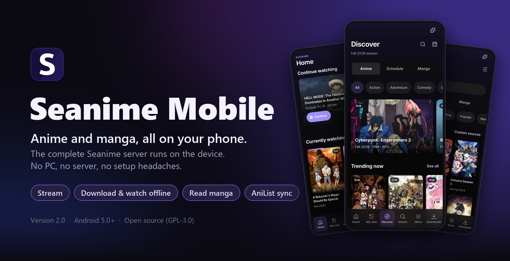
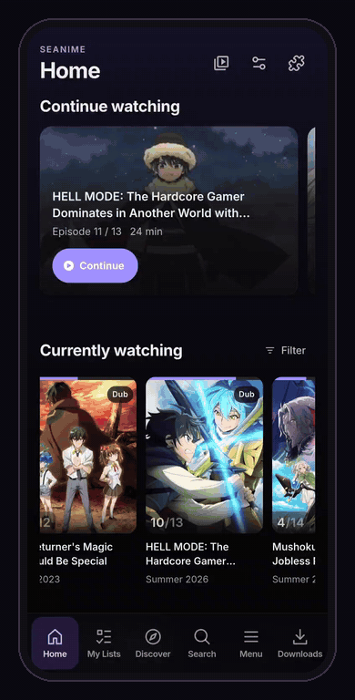
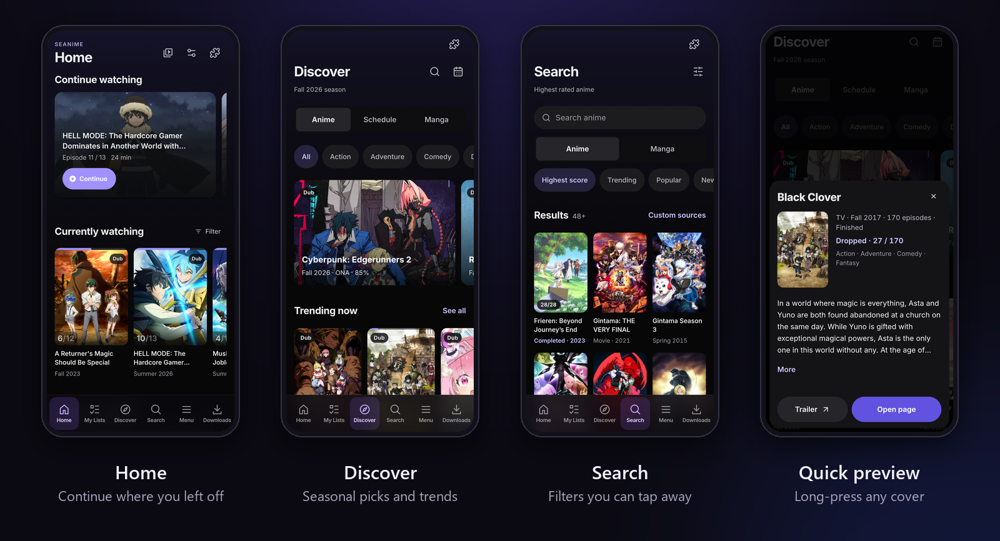
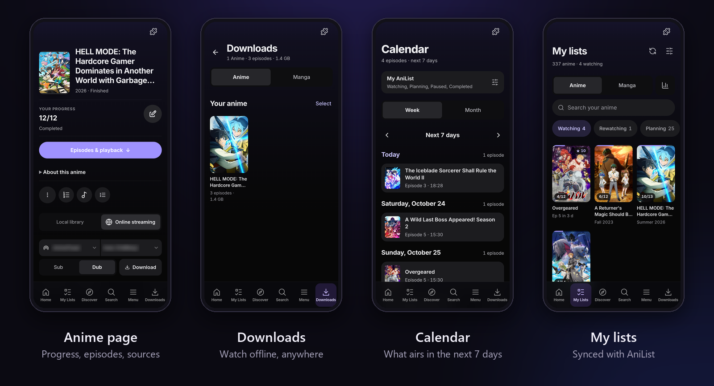
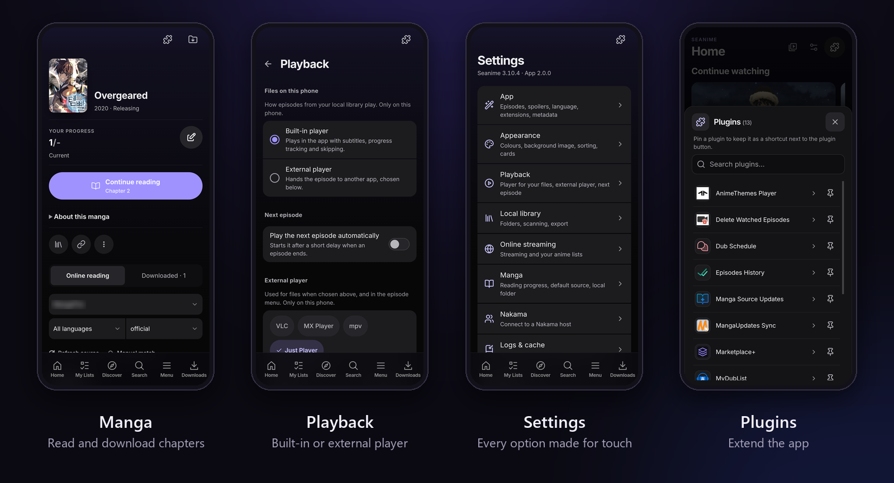

<p align="center">
  
</p>

<p align="center">
  <a href="https://github.com/Lampe332/seanime-mobile/releases/latest"></a>
  <a href="https://github.com/Lampe332/seanime-mobile/releases/latest"></a>
  
  <a href="LICENSE"></a>
</p>

<p align="center">
  <a href="https://github.com/Lampe332/seanime-mobile/releases/latest"><b>⬇️ Download the APK</b></a>
  &nbsp;·&nbsp; <a href="#-features">Features</a>
  &nbsp;·&nbsp; <a href="#-install">Install</a>
  &nbsp;·&nbsp; <a href="#-first-start">First start</a>
  &nbsp;·&nbsp; <a href="#-faq">FAQ</a>
  &nbsp;·&nbsp; <a href="CHANGELOG.md">Changelog</a>
</p>

---

**Seanime Mobile** puts [Seanime](https://github.com/5rahim/seanime) on your Android phone. The complete Seanime server runs inside the app, and every screen is built for touch, so you need no PC and no server of your own. Stream anime through extensions, download whole seasons for offline viewing, read manga and keep your AniList lists in sync, all from one app.

<table>
  <tr>
    <td width="42%" align="center"></td>
    <td>
      <h3>At a glance</h3>
      <ul>
        <li>📺 <b>Stream</b> with Sub or Dub, in the built-in player or an external one</li>
        <li>⬇️ <b>Download</b> a whole season and watch it offline</li>
        <li>📚 <b>Read manga</b> online or offline, with progress tracking</li>
        <li>🔄 <b>AniList sync</b> for lists, progress and scores</li>
        <li>📁 <b>Your own files</b> play from folders on your phone</li>
        <li>🧩 <b>Extensions and plugins</b> from the Seanime ecosystem</li>
        <li>🔔 <b>Updates itself</b> when a new version is out</li>
        <li>🌐 <b>English and German</b></li>
      </ul>
    </td>
  </tr>
</table>

## ✨ Features

### 📺 Watch
- Stream episodes through online streaming extensions; pick the source, the server and Sub or Dub on the anime page.
- The built-in player has picture-in-picture with back 10 s, play/pause and forward 10 s, a volume slider, skip opening / ending and your default audio and subtitle language.
- Subtitles can be translated from the player menu (Google works without a key).
- Prefer another player? Hand episodes to **VLC, MX Player, mpv or Just Player** with one tap.
- **Continue watching** on Home resumes the episode where you stopped.

### ⬇️ Download and watch offline
- Download a whole season or single episodes from the anime page.
- Everything you saved is in the **Downloads** tab; episodes you started offline wait in a **Continue offline** row.
- Downloaded episodes also show on their anime page and play without a connection.

### 📚 Read manga
- The Manga tab starts with **Continue reading**: chapter progress and new chapters at a glance, every list status as a tab.
- The reader has a page slider, tap-to-hide controls, brightness, a black, gray or white background and keep-screen-on.
- Download chapters to read them offline.

### 🔍 Discover and organise
- **Discover**: a seasonal spotlight, trending and top rows, each with "See all".
- **Search**: filters show as chips you can remove one by one, and more results load as you scroll.
- **Long-press any cover** for a quick preview, playlists and plugin actions.
- **My lists** with search, every AniList status and your stats; changes sync to AniList.
- **Calendar** with the next 7 days or the whole month.

### 📁 Your own library
- Pick folders with Android's folder picker; the scanner matches your files to AniList.
- Local episodes play in the built-in player. Browse the library's folders and fix matches right on the phone.

### 🧩 Extensions and plugins
- Install streaming and manga sources and plugins from community repositories.
- Plugin windows are laid out for touch, and you can pin your favourite plugins.

### 📱 Made for phones
- Bottom sheets instead of desktop dialogs, large touch targets and the Android Back button everywhere.
- A bottom bar you can rearrange: Home, My Lists, Discover, Search, Menu and Downloads.
- Settings save instantly; options for programs a phone cannot run are hidden.

## 📸 Screenshots

<p align="center"></p>
<p align="center"></p>
<p align="center"></p>

## 📲 Install

1. On your phone, open the **[latest release](https://github.com/Lampe332/seanime-mobile/releases/latest)** and download `Seanime-Mobile-x.y.z.apk` under *Assets*.
2. Open the downloaded file. The first time, Android asks you to allow **Install unknown apps** for your browser or file manager; allow it and go back.
3. Tap **Install**. The app is called *Seanime Mobile*.

> [!NOTE]
> **Play Protect** may warn you because the app does not come from the Play Store. Choose *More details → Install anyway*.

**Requirements:** Android 5.0 or newer on an ARM phone (64-bit or 32-bit), which covers practically every phone from recent years. Tested on a Samsung Galaxy S22 Ultra.

### Updates
The app checks this repository for new releases when it starts. When one is out, tap **Download and update**; the app verifies the download and Android asks you to confirm the install. Your data and downloads stay. You can turn the check off under *Settings → About → Look for new versions*, or run it yourself with *Check for updates now*.

## 🚀 First start

1. **Welcome screen.** Choose English or Deutsch, decide whether you want online streaming and manga, and tap **Start Seanime**.
2. **Permissions.** Android asks once about file access: **Allow file access** if you want to play your own files, or **Use streaming** without it. On Android 13 and newer it also asks to show notifications, for download progress and updates.
3. **Connect AniList.** Tap **Open AniList**, log in and allow Seanime, then **Paste** the token and tap **Connect**. Don't have an account? Create one for free at [anilist.co](https://anilist.co), or tap **Not now** to use a local account; you can sign in later from the Menu.
4. **Add sources.** Seanime Mobile ships **without** streaming or manga sources, and the official marketplace only contains plugins. A short tour starts on its own and shows you how to add a community repository:
   1. *Menu → Extensions* → **Marketplace** tab → **Change**.
   2. Paste the repository link (an address that ends in `.json`) and tap **Save**.
   3. Install a streaming source, then a manga source.

   Run the tour again any time from *Settings → App → Show the setup tutorial* or the ⋮ menu on the Extensions screen. This project does not link to any sources and has nothing to do with their content.
5. **Start watching.** Open an anime, tap **Episodes & playback** and pick an episode, or tap **Download** to save it for later.

## ❓ FAQ

<details>
<summary><b>Is this the official Seanime app?</b></summary>

No. Seanime Mobile is an independent, open-source fork that runs the Seanime server and interface on Android. Seanime itself is made by [5rahim](https://github.com/5rahim/seanime).
</details>

<details>
<summary><b>The pages say "No content yet"</b></summary>

That is expected on a fresh install. Connect AniList to see your lists and the catalog, and install a streaming or manga source to watch and read ([First start](#-first-start), step 4). The pages fill up right away; no restart needed.
</details>

<details>
<summary><b>An episode won't play</b></summary>

It is almost always the source. Choose another server or source on the anime page; servers marked "not directly playable" usually fail. Keeping your extensions up to date (*Menu → Extensions*) helps too.
</details>

<details>
<summary><b>"App not installed" when updating</b></summary>

An update must be signed with the same key as the installed app, which is the case for every release here. If you installed a self-built or third-party version before, uninstall it first; its downloads are removed with it.
</details>

<details>
<summary><b>Where are my downloads stored?</b></summary>

In the app's private storage. You find them in the **Downloads** tab, and Android removes them when you uninstall the app.
</details>

<details>
<summary><b>Are torrents or debrid services supported?</b></summary>

No. Torrent, debrid and auto-downloader features are turned off in the Android version. Downloads come from streaming sources.
</details>

<details>
<summary><b>Can I switch the language?</b></summary>

Yes: *Settings → App → Language* switches between English and German.
</details>

Found a bug or have an idea? [Open an issue](https://github.com/Lampe332/seanime-mobile/issues) and include your phone model, Android version and app version (*Settings → About*).

## 🛠️ Build it yourself

The repository holds the complete source: the Android app (Kotlin), the Seanime server (Go) and the interface (React). Step-by-step instructions are in **[docs/BUILD.md](docs/BUILD.md)**.

```
app/            Android app: Kotlin, WebView, player, downloads, updater
backend/        Seanime server (Go) and the web interface (backend/seanime-web, React)
docs/           Build guide, README images, upstream documentation, development notes
tests/          Phone UI tests (Python and Playwright)
Build.ps1       Full release build including the backend
```

## 🙏 Credits and license

- [**Seanime**](https://github.com/5rahim/seanime) by 5rahim: server and web interface
- [**Seanime Android**](https://github.com/Pal-droid/Seanime-Android) by Pal-droid: the original Android port ([original README](docs/upstream/README.md))

Seanime Mobile is licensed under the **GPL-3.0**, like the projects it builds on ([LICENSE](LICENSE)). The app hosts no content; it only shows what your installed extensions provide.
