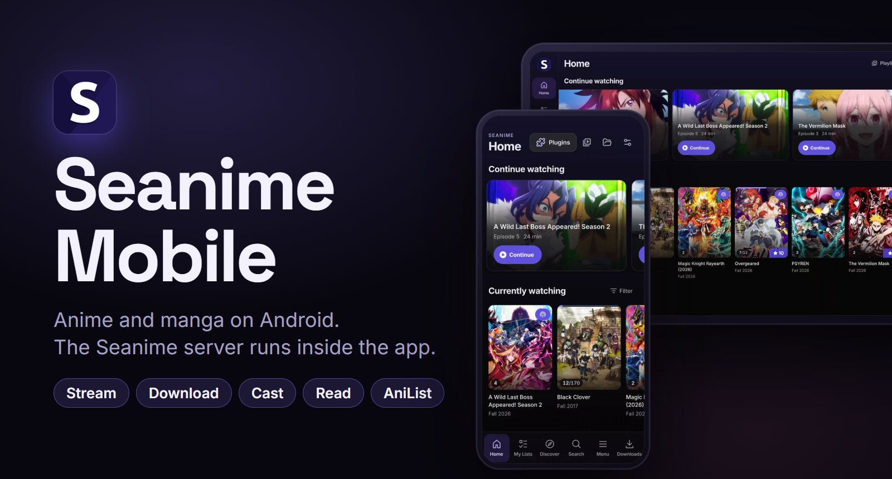
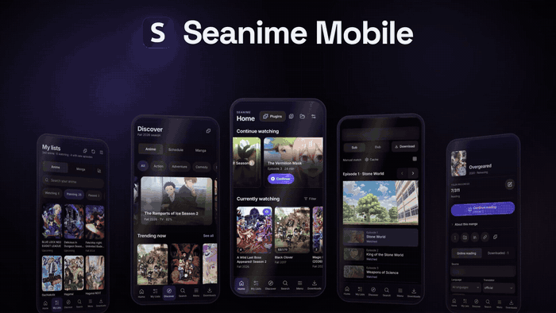
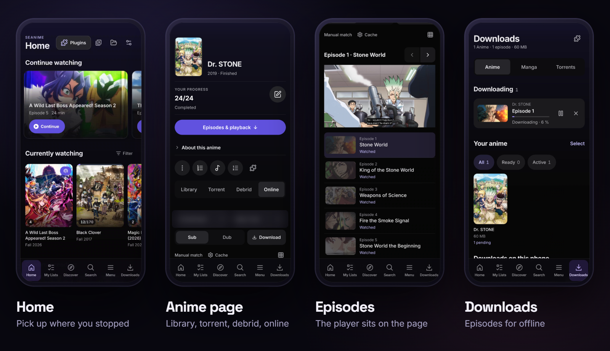
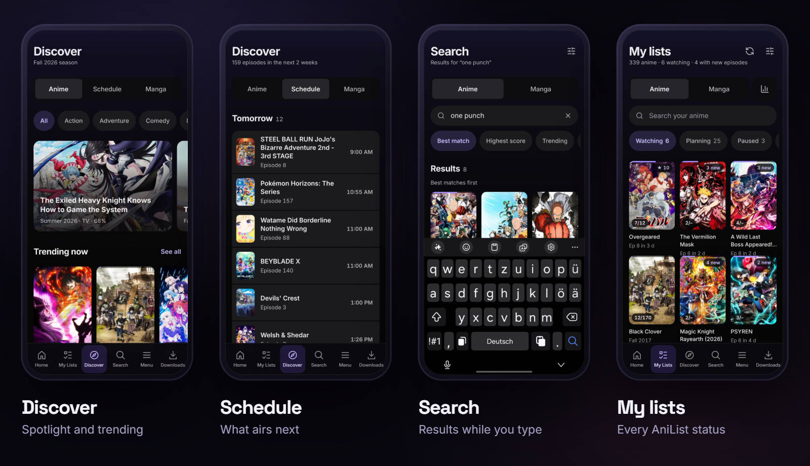
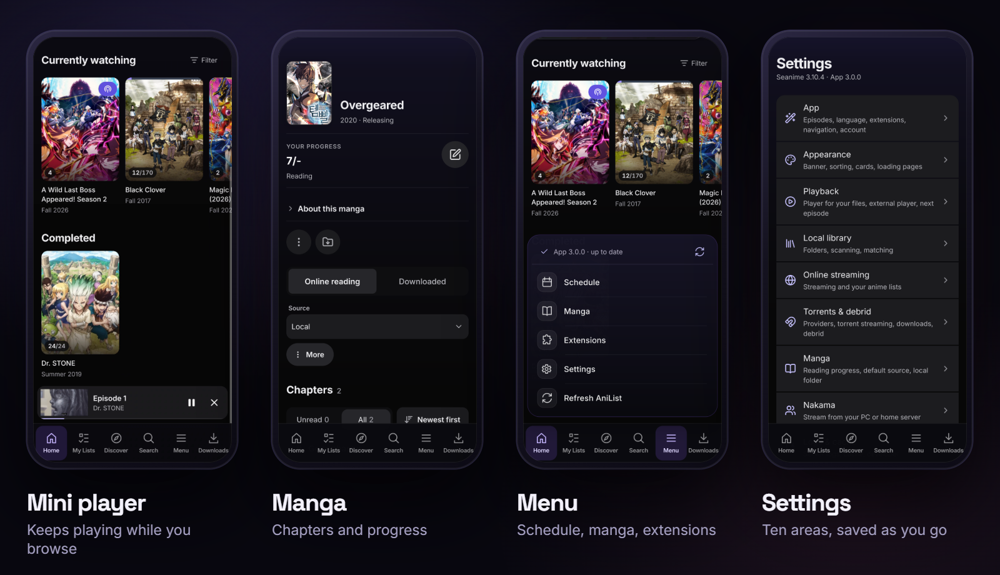
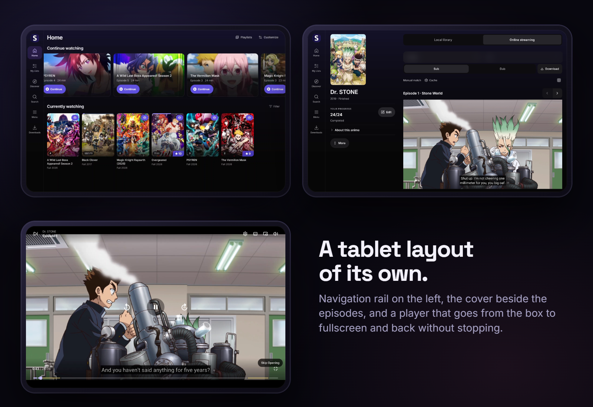

<p align="center">
  
</p>

<p align="center">
  <a href="https://github.com/Lampe332/seanime-mobile/releases/latest"></a>
  
  <a href="LICENSE"></a>
</p>

<p align="center"><a href="https://github.com/Lampe332/seanime-mobile/releases/latest"><b>Download the latest APK</b></a> &nbsp;·&nbsp; <a href="#install">Install</a> &nbsp;·&nbsp; <a href="#first-start">First start</a> &nbsp;·&nbsp; <a href="#faq">FAQ</a> &nbsp;·&nbsp; <a href="CHANGELOG.md">Changelog</a></p>

[Seanime](https://github.com/5rahim/seanime) is a server you run on a computer and open in a browser. Seanime Mobile puts that server inside an Android app, so a phone or a tablet is all you need. You stream anime through extensions or torrents, save episodes for later, read manga and keep your AniList lists in sync. If Seanime already runs on your PC or home server, the app plays that library too.

<p align="center">
  <a href="docs/images/readme/intro.mp4"></a>
</p>

<p align="center"><sub>A cut of the intro video. Click it for the full version with sound and a narrator. Every screen in it is a recording of the app on a Galaxy S22 Ultra and a Pixel Tablet.</sub></p>

## At a glance

- Stream with Sub or Dub in the built-in player, or hand an episode to VLC, MX Player, mpv or Just Player
- The episode plays in a box on the anime page, goes fullscreen with one tap and keeps playing in a mini player while you browse
- Download episodes and watch them offline
- Stream or download torrents, or go through a debrid service
- Play the library of Seanime on your PC or home server
- Cast an episode to a TV on your Wi-Fi
- Read manga online or offline
- AniList sync for lists, progress and scores
- Notifications when a new episode of a show you watch is out
- Phone and tablet layouts in one APK, in English or German

## New in 3.0: a native app

Up to 2.0.33 the app was a web page inside a web view. Version 3.0 is a rebuild from the ground up as a native Android app, written with React Native and Expo. Every screen, list, menu and animation is now drawn by Android itself, and the layout you know from 2.0.33 stayed. The Seanime server still runs inside the app, as before.

What you notice: Home and My lists scroll with fewer dropped frames, the app comes back from the background faster, and one player (mpv) plays every episode, whatever the source. The [changelog](CHANGELOG.md) has the full list, and [Updating from 2.0.x to 3.0](#updating-from-20x-to-30) says what to check before you update.

The app continues Pal-droid's [Seanime Android](https://github.com/Pal-droid/Seanime-Android) port, which is archived and stopped at Seanime 3.5.2. Seanime Mobile runs Seanime 3.10.4. New versions come out often. You find the newest on the [releases page](https://github.com/Lampe332/seanime-mobile/releases/latest), and the app tells you when one is out.

## Good to know before you install

- **No sources included.** The app ships without streaming, torrent or manga sources. You add them from a community extension repository ([First start](#first-start), step 4). This project does not link to any.
- **Android on ARM.** The APK runs on 64-bit and 32-bit ARM phones and tablets with Android 7.0 or newer. There is no iOS version.
- **Not tested yet in 3.0.** Casting to a TV, debrid, Nakama and external players were carried over to the native app, but nobody has tried them on a real TV, a debrid account or a second server yet.
- **Plugins.** Plugin tray buttons, actions and plugin windows work. Plugins that change the app's own page (DOM plugins, for example the dub badge) and plugin episode tabs do not run in 3.0.
- **Not the official app.** Seanime Mobile is an independent, open-source fork of Seanime under the GPL-3.0.
- **Torrents are up to you.** They only work with torrent providers you install yourself, and they use your connection, mobile data included; the app asks before a torrent starts on mobile data. The auto-downloader is not available on Android.

## What it does

### Watch and download

<p align="center"></p>

Open an anime, pick a source, a server and Sub or Dub, and press play. The episode starts in a box on the page, above the episode list. The button at the bottom right makes it fullscreen and brings it back, and the episode does not pause or reload on the way. Back in fullscreen also makes the player small. Leave the anime page and the episode moves into a mini player above the navigation bar (a card on tablets): tap it to go back to fullscreen, or close it with ×. Episodes from your library, torrents and debrid start fullscreen and use the same box and mini player once you make them small.

The player is mpv. It plays every episode, including AC3, DTS and TrueHD audio, ASS subtitles and all tracks of MKV files, and switches tracks without reloading. It has picture-in-picture with back 10 s, play/pause and forward 10 s, lock screen and notification controls, a sleep timer, Fit, Zoom and Stretch, and swipes for brightness and volume. It skips openings and endings, remembers your audio and subtitle language for each anime, and can translate subtitles into another language. Prefer another player? One tap hands the episode to VLC, MX Player, mpv or Just Player.

**Cast to a TV** sends the episode to a TV on your Wi-Fi over DLNA and turns the player into a remote. Google Cast for Google TV and Chromecast is included too, without subtitles. Both are untested in 3.0 so far.

The same page downloads single episodes or a whole season. Downloads can wait for Wi-Fi, notify you when they finish or fail, and play without a connection from the **Downloads** tab. **Continue watching** on Home resumes where you stopped, and the app can notify you when a new episode of a show you are watching comes out.

### Find something new

<p align="center"></p>

Discover opens with the season's spotlight, then genre chips and rows for trending, recent and upcoming shows, each with *See all*. The schedule lists what airs over the next two weeks. In Search, results come in while you type, sort chips change their order, and more results load as you scroll. Long-press a cover for a quick preview, playlists and plugin actions. **My lists** has search, every AniList status and your stats, and your changes go straight to AniList.

### Mini player, manga and settings

<p align="center"></p>

The Manga tab starts with *Continue reading*. The reader has a page slider, pinch and double-tap zoom, swipes to turn pages, brightness, a black, gray or white background and keep-screen-on. You can sort chapters, jump to one, and download chapters to read offline. On a tablet the reader switches between single and double pages on its own.

Settings come in ten areas: App, Appearance, Playback, Local library, Online streaming, Torrents & debrid, Manga, Nakama, Logs & cache and About. Changes save the moment you make them. A few things live only in the app: notifications for new episodes with a button to send a test, downloads only on Wi-Fi, and haptics with a quiet sound for downloads and watched episodes.

### Torrents, debrid and your home server

With a torrent provider installed, you can stream an episode straight into the built-in player or download it into your library folder with the app's own torrent client: one episode, a whole season or only the episodes you are missing. The torrent sheet searches several providers at once. You filter by resolution, language, 10-bit, codec, source and size, search inside the results and sort them by seeders, date or size. An auto-select profile under *Settings → Torrents & debrid* (release groups, languages, codecs, exclusions) can pick a release for you. **Downloads → Torrents** shows progress and speed. Debrid works with your own TorBox, Real-Debrid, AllDebrid or Premiumize account, for streaming and for downloads.

Under **More → Tabs** on an anime page you choose which tabs (Torrent, Debrid, Online) show up.

Already run Seanime on a computer or home server? Connect the app through **Nakama** and that library joins the episodes on your device. Nothing gets copied, and the settings show whether you are connected. ([Setup](#faq))

### Phones and tablets

<p align="center"></p>

One APK covers both. The app picks its layout from the screen width: a phone gets the bottom bar, a tablet gets a navigation rail on the left, settings in two panes, sheets that slide in from the side, and anime and manga pages where the cover stays on the left while the episodes or chapters scroll on the right. On a tablet, fullscreen fills the screen in whatever way you hold it.

### Your own files, extensions and the rest

- Pick folders with Android's folder picker. The scanner matches your files to AniList, and you can fix matches on the device.
- Install streaming sources, manga sources, torrent providers and plugins from community repositories.
- Bottom sheets instead of desktop dialogs, the Android Back button everywhere, and a bottom bar you can rearrange.
- Launcher shortcuts, a home screen widget for upcoming anime, and text shared to the app opens a search.

## Install

1. On your device, open the **[latest release](https://github.com/Lampe332/seanime-mobile/releases/latest)** and download `Seanime-Mobile-x.y.z.apk` under *Assets*.
2. Open the downloaded file. The first time, Android asks you to allow **Install unknown apps** for your browser or file manager. Allow it and go back.
3. Tap **Install**. The app is called *Seanime Mobile*.

> [!NOTE]
> **Play Protect** may warn you because the app does not come from the Play Store. Choose *More details → Install anyway*.

### Updates

The app checks this repository for new releases when it starts. When one is out, tap **Download and update**. The app only installs the download when it matches the checksum GitHub publishes for it, and Android asks you to confirm. Your data and downloads stay. Turn the check off under *Settings → About → Look for new versions*, or run it yourself with *Check for updates now*.

### Updating from 2.0.x to 3.0

3.0 is the same app (`com.seanime.app.local`, same signature), so it installs over 2.0.33 as a normal update: through the update window in 2.0.33, or by downloading `Seanime-Mobile-3.0.0.apk` and installing it. Your library, lists, server settings, extensions, language and downloaded episodes stay. Before you update:

- 3.0 needs Android 7.0 or newer. On Android 5 or 6, stay on 2.0.33.
- Preferences that 2.0.x kept inside its web view start from their defaults, for example the navigation bar order, the subtitle style and the manga reader options.
- Android no longer backs up the app's data. When you move to a new phone, set the app up again there.
- If the "Upcoming anime" widget disappears from the home screen, add it again.
- The APK is larger than 2.0.33: about 107 MB instead of 70 MB.

The full list is in the [changelog](CHANGELOG.md).

## First start

1. **Welcome screen.** Choose English or Deutsch, decide whether you want online streaming and manga, and tap **Start Seanime**.
2. **Permissions.** Android asks once about file access: **Allow file access** if you want to play your own files, or **Use streaming** without it. On Android 13 and newer it also asks to show notifications, for download progress, new episodes and updates.
3. **Connect AniList.** Tap **Open AniList**, log in and allow Seanime, then **Paste** the token and tap **Connect**. No account? Make one for free at [anilist.co](https://anilist.co), or tap **Not now** to use a local account and sign in later.
4. **Add sources.** The app ships **without** streaming or manga sources, and the official marketplace only has plugins. A short animated tour starts on its own, points at each button and walks you through adding a community repository:
   1. *Menu → Extensions* → **Marketplace** tab → **Change**.
   2. Paste the repository link (an address that ends in `.json`) and tap **Save**.
   3. Install a streaming source, then a manga source. For torrents, also install a torrent provider; it then shows up under *Settings → Torrents & debrid*.

   You can run the tour again from *Settings → App → Show the setup tutorial* or the ⋮ menu on the Extensions screen. This project does not link to any sources and has nothing to do with their content.
5. **Start watching.** Open an anime, tap **Episodes & playback** and pick an episode, or tap **Download** to save it for later.

## FAQ

<details>
<summary><b>The pages say "No content yet"</b></summary>

That is expected on a fresh install. Connect AniList to see your lists and the catalog, and install a streaming or manga source to watch and read ([First start](#first-start), step 4). The pages fill up right away; no restart needed.
</details>

<details>
<summary><b>An episode won't play</b></summary>

It is almost always the source. Pick another server or source on the anime page. Keeping your extensions up to date (*Menu → Extensions*) helps too.
</details>

<details>
<summary><b>How do I close the player?</b></summary>

Back in fullscreen makes the player small. It then sits in the box on its anime page, or in the mini player on every other page. The mini player's × closes it and saves your position.
</details>

<details>
<summary><b>"App not installed" when updating</b></summary>

An update has to be signed with the same key as the installed app, which is true for every release here. If you installed a self-built or third-party version before, uninstall it first; its downloads go with it.
</details>

<details>
<summary><b>Where are my downloads stored?</b></summary>

Episodes from streaming sources live in the app's private storage. You find them in the **Downloads** tab, and Android deletes them when you uninstall the app. Torrent downloads go into your library folder (*Settings → Local library*) and stay there; they show under **Downloads → Torrents** and in your library.
</details>

<details>
<summary><b>How do I stream from my PC or home server?</b></summary>

1. On the computer or server, open Seanime → *Settings → Nakama*: **Enable Nakama**, **Enable host mode**, set a **Passcode** and turn on **Share local anime library**.
2. In the app, open *Settings → Nakama*: turn **Nakama** on, enter the **Host address** (the computer's IP address and port, like `192.168.1.20:43211`) and the **Host passcode**, and turn on **Use the host's anime library**.
3. The row below says **Connected to …**, and the server's anime appear in your library. Open one and tap an episode.

Both devices need to be on the same network, unless you make the server reachable from outside, for example through a VPN like Tailscale. Nakama was tested with 2.0.x; 3.0 has not been tried against a second server yet.
</details>

<details>
<summary><b>Which TVs can I cast to?</b></summary>

Casting uses DLNA, which many smart TVs support. Version 2.0.x was tested with an LG webOS TV; 3.0 has not been tested on a TV yet. Google Cast (Google TV, Chromecast) is built in as well, but without subtitles and so far untested on a real device. Phone and TV need to be on the same Wi-Fi.
</details>

<details>
<summary><b>How is this different from Seanime Tenji?</b></summary>

[Tenji](https://seanime.app/docs/tenji) is the official Seanime app for phones. It is a client, so it connects to a Seanime server: either on your computer, or the official [Seanime Server (Mobile)](https://seanime.app/docs/mobile-server) as a second app on the phone. Seanime Mobile is an unofficial fork that bundles the server and the interface in one APK. If you prefer the official route, use Tenji.
</details>

<details>
<summary><b>Can I switch the language?</b></summary>

Yes: *Settings → App → Language* switches between English and German.
</details>

Found a bug or have an idea? [Open an issue](https://github.com/Lampe332/seanime-mobile/issues) with your device model, Android version and app version (*Settings → About*).

## Build it yourself

The repository holds the complete source: the native Android app (React Native and Expo, TypeScript) and the Seanime server (Go). The 3.x app is built with `native/scripts/build-android.ps1`; its header lists the steps and options. **[docs/BUILD.md](docs/BUILD.md)** still describes the 2.0.x web-view app, whose sources stay in the repository for now.

```
native/         Android app 3.x: React Native + Expo (TypeScript), build script in native/scripts
backend/        Seanime server (Go); backend/seanime-web is the web interface of 2.0.x
app/            Android app 2.0.x: Kotlin and WebView
docs/           Build guide (2.0.x), README images and the intro video, the original Android port's README
tests/          UI tests of 2.0.x (Python and Playwright)
Build.ps1       Signed release build of 2.0.x including the backend
```

## Credits and license

- [**Seanime**](https://github.com/5rahim/seanime) by 5rahim: server and web interface, which the native screens are ported from
- [**Seanime Android**](https://github.com/Pal-droid/Seanime-Android) by Pal-droid: the original Android port ([original README](docs/upstream/README.md))
- [**mpv**](https://mpv.io) through [expo-mpv](https://www.npmjs.com/package/expo-mpv): the player

Seanime Mobile is licensed under the **GPL-3.0**, like the projects it builds on ([LICENSE](LICENSE)). The app hosts no content; it only shows what your installed extensions provide.
