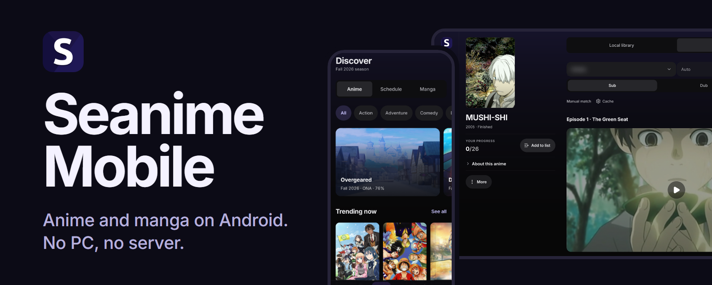
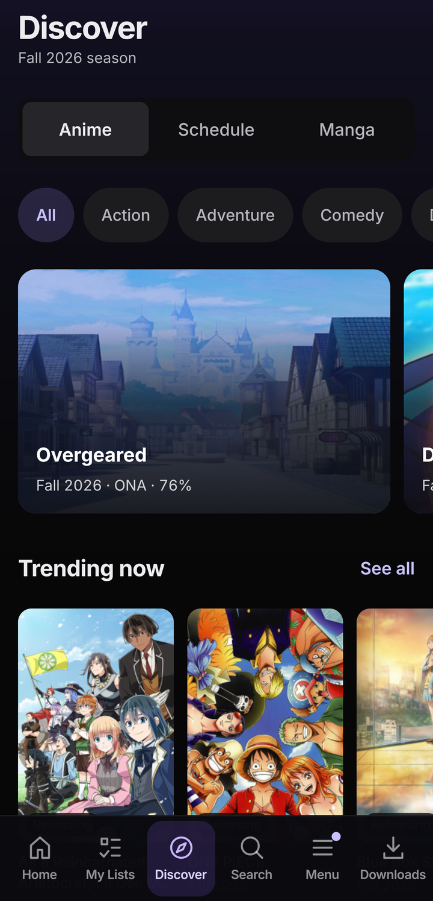
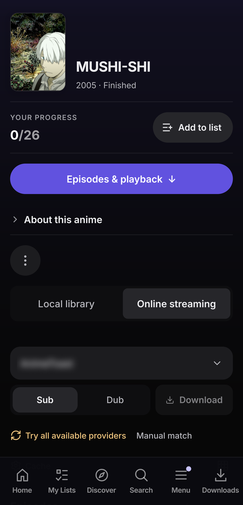
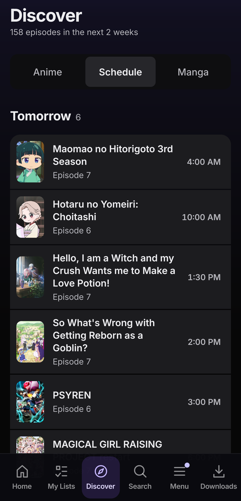
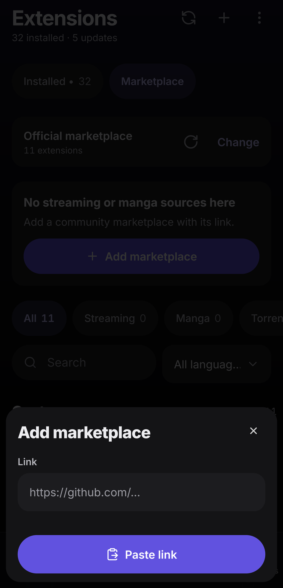
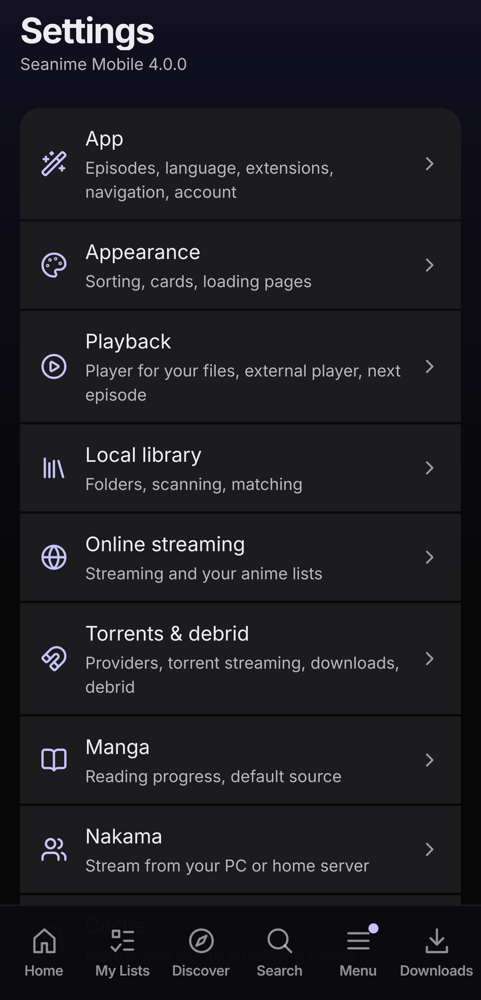
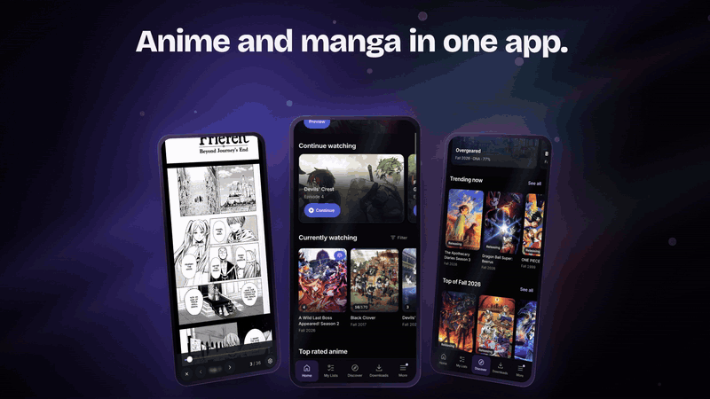

  

<h1 align="center">Seanime Mobile</h1>

  <b>Anime and manga on your Android phone or tablet.</b> 
  Stream or download episodes, read manga, and keep your AniList in sync. 
  Free, open source, no ads. No PC and no server at home.

  
  &nbsp;
  

  
  
  

  <a href="https://seanimemobile.com">Website</a> &nbsp;·&nbsp;
  <a href="#install">Install</a> &nbsp;·&nbsp;
  <a href="#first-start">First start</a> &nbsp;·&nbsp;
  <a href="#faq">FAQ</a> &nbsp;·&nbsp;
  <a href="https://discord.gg/dxJdj5Dqt9">Discord</a> &nbsp;·&nbsp;
  <a href="CHANGELOG.md">Changelog</a>

Unofficial · built on <a href="https://github.com/5rahim/seanime">Seanime</a> by 5rahim. Not the official Seanime app.

  

## Why use it

- **Everything runs on the device.** The app has its own core, so there is no PC or home server to keep alive.
- **No account needed.** Log in with AniList, or use a local account that keeps your lists on the phone.
- **No ads, no price tag.** It's free software under the GPL-3.0, and the code is right here.
- **One APK for phones and tablets.** Tablets get a layout of their own.

  
  
  
  

Version 4.0 on a Galaxy S22 Ultra and a Pixel Tablet.

## What it does

<table>
  <tr><td><b>Watch</b></td><td>Stream from the sources you install, online or by torrent, with Sub or Dub. The player is mpv, so AC3, DTS, ASS subtitles and every track of an MKV just play.</td></tr>
  <tr><td><b>Download</b></td><td>Keep episodes and chapters on the device for when there's no connection.</td></tr>
  <tr><td><b>Read</b></td><td>Manga, online or offline. The Manga tab picks up where you stopped.</td></tr>
  <tr><td><b>Track</b></td><td>Your AniList lists and progress stay in sync. If AniList is down, your changes wait on the phone and go out later.</td></tr>
  <tr><td><b>Cast</b></td><td>Send an episode to your TV over DLNA, or play your PC's Seanime library through Nakama.</td></tr>
  <tr><td><b>Tablets</b></td><td>A navigation rail, settings in two panes, and anime pages where the cover stays put while the episodes scroll.</td></tr>
</table>

The smaller things

 

- The app can fetch the next one to three episodes of what you're watching on its own (Wi-Fi only), and delete the ones you've watched. Both are off until you switch them on.
- *Menu → History* lists what you watched and read, day by day.
- *Menu → Updates* gathers new episodes and chapters since your last visit. The app can also notify you when a manga on your list gets a new chapter.
- Incognito mode pauses the history and the automatic progress updates. An episode you mark yourself still goes to AniList.
- There's a *Continue watching* widget for your home screen. Add it from *Settings → App*.
- *Settings → App → Backup* writes settings, watch positions, playlists, extensions and the local account's lists into one file. Restore shows what the file holds before it changes anything, and you can undo the last restore. Tokens and passwords never go into the file.
- Long-press a cover for quick actions: add to list, +1 episode or chapter, continue reading.

More screenshots

 

  

  
  
  

Want a guided look first? The [website](https://seanimemobile.com) has a tap-through tour of the app and the full feature list.

## See it run

  

Recorded with version 3.0. Most screens still look like this; some details have changed since.

## Install

1. On your phone or tablet, open the [latest release](https://github.com/Lampe332/seanime-mobile/releases/latest) and download the `Seanime-Mobile` APK under *Assets*. It's about 71 MB.
2. Open the file. The first time, Android asks you to allow *Install unknown apps* for your browser or file manager. Allow it and go back.
3. Tap *Install*. Play Protect may warn you because the app doesn't come from the Play Store. Choose *More details → Install anyway*.

Stuck on one of those steps? [seanimemobile.com/help](https://seanimemobile.com/help) walks through them one by one, shows how to check the file's SHA-256 checksum, and lists fixes for common problems.

From then on the app offers updates itself. It checks this repository for a new release when it starts, and it installs a download only when it matches the checksum GitHub publishes for it.

> [!IMPORTANT]
> **Still on 2.0.33?** Its updater refuses 4.0 with "APK does not support this device". Download the APK by hand and install it over the old app. Your data stays, and downloaded episodes, chapters and installed extensions are taken over on the first start. From 3.0.0 the update arrives in the app as usual.

## First start

1. Pick your language (English or Deutsch) and tap *Get started*.
2. Log in with AniList. Allow access there and copy the code it shows. Back in the app, it finds the code and offers *Connect*. No account? Make one for free at [anilist.co](https://anilist.co), or tap *Not now* and use the local account.
3. Add sources. None are installed at first. A short tour shows the way: *Menu → Extensions → Marketplace*. The official Seanime marketplace by 5rahim is set by default, but right now it has no streaming or manga sources. For those, add a community marketplace: paste its link, check the preview, add it. The [setup guide on the website](https://seanimemobile.com/#start) has one ready to copy. Then install a streaming source and a manga source.

This project has nothing to do with the content of extensions. Community extensions get scanned automatically, but nobody checks them by hand, so only install what you trust.

## Good to know

It runs on 64-bit and 32-bit ARM devices with Android 7.0 or newer. There is no iOS version.

Torrents only work with torrent providers you install, and they use your connection, mobile data included. The app asks before a torrent starts on mobile data.

Not everything is tested on real hardware. Debrid isn't yet. Nakama was tested as a guest of Seanime on a PC (library and playback), and casting over DLNA on an LG TV, without checking subtitles on the TV.

What 4.0 no longer has

 

Some features needed the built-in server of the older versions and did not come back: plugins, Discord status, Nakama watch parties and cloud rooms, filler marking, custom source lists, debrid downloads into a folder, tracking in external players, searching other manga sources, local manga and the double-page reader view. *Export library data* is gone too; Backup replaces it.

## If you know Seanime

Seanime Mobile started as a fork of [Seanime](https://github.com/5rahim/seanime), 5rahim's media server for anime and manga. Up to 3.0 the APK carried that whole server and ran it in the background. Since 4.0 the server is gone and the app runs on its own core, written in TypeScript, with a few native modules for torrents, casting and extensions. The download shrank from about 107 MB to about 71 MB, and Home shows your lists right after start.

What stayed: the screens are derived from Seanime's web interface, and extensions use Seanime's format. You don't need Seanime on a PC. If you have it anyway, Nakama plays its library on your phone.

This is not the official app. That one is [Tenji](https://seanime.app/docs/tenji), a client for a Seanime server on your computer or on the phone. If you prefer the official route, use Tenji.

## FAQ

The pages say "No content yet"

 

Normal on a fresh install. Connect AniList to see your lists and the catalog, and install a streaming or manga source to watch and read ([First start](#first-start), step 3).

An episode won't play

 

It's almost always the source. Pick another server or source on the anime page, and keep your extensions up to date (*Menu → Extensions*).

"App not installed" when updating

 

An update has to be signed with the same key as the installed app, and every release here is. If you installed a self-built or third-party version before, uninstall it first; its downloads go with it.

Do I need an AniList account?

 

No. The local account keeps lists and progress on the device, and *Upload local lists* moves them to AniList if you sign in later.

Where do I find more help, and what does the app send where?

 

[seanimemobile.com/help](https://seanimemobile.com/help) covers installing, checking the file, updates and common problems. The [privacy page](https://seanimemobile.com/privacy) explains what the app sends where and which permissions it uses for what.

Found a bug or have an idea? [Open an issue](https://github.com/Lampe332/seanime-mobile/issues) with your device model, Android version and app version (*Settings → About*). For questions, help with setup or just to chat, join the [Discord server](https://discord.gg/dxJdj5Dqt9).

## Support

Seanime Mobile is free and stays free: no ads, no paywalled features. I build it in my spare time, so if the app is useful to you and you'd like to say thanks, you can buy me a coffee on Ko-fi. It's completely optional, and a bug report or a star helps too.

## Build it yourself

The app lives in `native/`: React Native and Expo in TypeScript, the core in `native/src/core/`, the native modules in `native/modules/`. Build instructions are in [docs/BUILD.md](docs/BUILD.md).

## Credits and license

Seanime Mobile is built on [**Seanime**](https://github.com/5rahim/seanime) by **5rahim**, licensed under the GPL-3.0. It started as a fork of Seanime and now runs its own core; the screens are derived from Seanime's web interface (seanime-web), and the extension format and contract are Seanime's. Seanime Mobile is not affiliated with Seanime or 5rahim.

- [Seanime Android](https://github.com/Pal-droid/Seanime-Android) by Pal-droid: the original Android port ([original README](docs/upstream/README.md))
- [mpv](https://mpv.io) through [expo-mpv](https://www.npmjs.com/package/expo-mpv): the player
- [libtorrent](https://www.libtorrent.org) (BSD-3-Clause), [BoringSSL](https://boringssl.googlesource.com/boringssl), [Boost](https://www.boost.org) (Boost Software License 1.0), [quickjs-ng](https://github.com/quickjs-ng/quickjs) (MIT) and [libsodium](https://libsodium.org) (ISC) in the native modules

The full license texts of these and the bundled JavaScript libraries are in [`licenses/`](licenses/). The old server code and the earlier apps are still in the git history.

Seanime Mobile is licensed under the GPL-3.0 ([LICENSE](LICENSE)). The app hosts no content; it only shows what your installed extensions provide.

## Legal

Nick Schäfer · Kanton Basel-Landschaft, Switzerland · info@seanimemobile.com

- Website: [seanimemobile.com](https://seanimemobile.com)
- Privacy policy: [seanimemobile.com/privacy](https://seanimemobile.com/privacy)
- Imprint: [seanimemobile.com/imprint](https://seanimemobile.com/imprint)

Unofficial app, built on Seanime by 5rahim. No telemetry, no analytics. The same details are in the app under *Settings → About → Legal*.

Website: <a href="https://seanimemobile.com">seanimemobile.com</a> · <a href="https://seanimemobile.com/help">Help</a> · <a href="https://discord.gg/dxJdj5Dqt9">Discord</a> · <a href="https://seanimemobile.com/privacy">Privacy</a> · <a href="https://seanimemobile.com/security">Security</a> · <a href="https://seanimemobile.com/imprint">Imprint</a>

