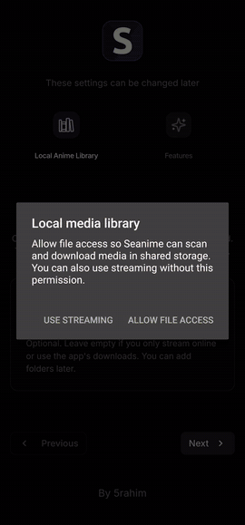

<p align="center">
  
</p>

<p align="center">
  <a href="https://github.com/Lampe332/seanime-mobile/releases/latest"></a>
  <a href="https://github.com/Lampe332/seanime-mobile/releases/latest"></a>
  
  <a href="LICENSE"></a>
</p>

<p align="center">
  <a href="https://github.com/Lampe332/seanime-mobile/releases/latest"><b>⬇️ Download APK</b></a>
  &nbsp;·&nbsp; <a href="#-installing-on-your-phone">Installation</a>
  &nbsp;·&nbsp; <a href="#-first-time-setup">Setup</a>
  &nbsp;·&nbsp; <a href="#-tutorial-video">Tutorial video</a>
  &nbsp;·&nbsp; <a href="docs/BUILD.md">Build it yourself</a>
  &nbsp;·&nbsp; <a href="CHANGELOG.md">Changelog</a>
</p>

---

**Seanime Mobile** brings [Seanime](https://github.com/5rahim/seanime) entirely to your Android phone: the Seanime server runs directly on the device, and the interface is adapted for touch. No PC and no server of your own required. Stream anime, download whole seasons and watch offline on the go. On top of that you get manga, AniList sync and a release calendar.

## ✨ Features

| Feature | Description |
|---|---|
| 📺 **Streaming** | Watch anime right in the app via online streaming extensions |
| ⬇️ **Season downloads** | Download a whole season, "from episode …" or single episodes, with a queue that survives an app restart |
| ✈️ **Offline viewing** | Dedicated offline player with fullscreen, −5/+10 s, playback speed, subtitles and resume; covers and info stay visible offline |
| 📚 **Manga** | Read and download chapters, open them offline in the reader |
| 📅 **Calendar** | Monthly calendar with all episodes from your AniList list or from all anime, filterable by status |
| 🔄 **AniList** | Lists, progress and ratings are synced with AniList |
| 🧩 **Extensions & plugins** | Sources and plugins from the Seanime ecosystem |
| 🧭 **Setup tutorial** | An interactive tour on first launch shows how to add a repository and install sources |

## 📱 Screenshots

<p align="center"></p>
<p align="center"></p>
<p align="center"></p>

> The app's own interface is currently partly in German, so some labels inside the screenshots are German.

## 📲 Installing on your phone

1. On your phone, open the latest **[Seanime Mobile APK](https://github.com/Lampe332/seanime-mobile/releases/latest)** and download the `.apk` under *Assets*.
2. Tap the downloaded file (from the notification or *My Files → Downloads*).
3. The first time, Android asks for the **"Install unknown apps"** permission. Allow it for your browser or file manager and go back.
4. Tap **Install**. Done: the app is called *Seanime Mobile*.

> **Updating:** Simply install the new APK over the old one; your data and downloads are kept.
> **Play Protect** may show a warning because the app doesn't come from the Play Store. Choose *Install anyway*.

Supported: Android 5.0 or newer, ARM64 and ARMv7 (practically every phone from recent years). Tested on a Samsung Galaxy S22 Ultra.

## 🚀 First-time setup

1. **Open the app.** A short wizard asks for an anime folder (optional, leaving it empty is fine) and which features to use. Tap **Launch Seanime**. Android will also ask for file access (*Use streaming* is enough) and notifications (for download progress).
2. **Log in with AniList.** In the dialog, tap **Get AniList token**, confirm in the browser and paste the token. You can create a free account at [anilist.co](https://anilist.co). To skip login, close the dialog with ✕ and the app will use a local account.
3. **Add sources.** An **interactive tutorial** then starts automatically and guides you through the following steps ([video](#-tutorial-video)). To run it again later: *Settings → Extensions → Show tutorial*.
   The app ships **without** any streaming or manga sources. The official Seanime marketplace only contains plugins. Sources come from community repositories that you add yourself:
   1. Open *Menu → Extensions* and select the **Marketplace** tab at the top.
   2. Tap **Change repository** and paste the **repository URL** (an address ending in a `.json` file). You can find suitable Seanime extension repositories online in the Seanime community.
   3. The list reloads. Select **Online Streaming** (or **Manga**) at the top and tap the **download icon** next to the extension you want.
   4. Alternatively: in the *Installed* tab → **Add extensions** → **Import from repository**. This installs all extensions from a repository at once.

   Without an extension, the app can only display anime and manga, not play or read them. Torrent extensions do not work in the Android version.
4. **Get started.** Tap an anime → *Online streaming* to watch, or *Download season / episodes* for offline viewing. Your saved content is in the **Downloads** tab at the bottom.

## 🎬 Tutorial video

This is what the first launch with the built-in tutorial looks like: wizard, adding a repository, installing a streaming extension. The repository address and the extension names are blurred in the video.

<p align="center">
  
</p>
<p align="center"><a href="docs/images/tutorial.mp4">▶️ Full-quality video (MP4)</a></p>

## ❓ FAQ

<details>
<summary><b>"App not installed" when updating</b></summary>

The new APK must be signed with the same key as the installed one. That is the case for all official releases here. If you previously installed a self-built or third-party version, uninstall the old app first (local downloads will be lost).
</details>

<details>
<summary><b>"No content providers available" / no streaming sources</b></summary>

This is normal on a fresh install: the default marketplace contains no streaming or manga sources. Add a community repository as described in [First-time setup](#-first-time-setup), step 3. This project deliberately does not link to any sources and has nothing to do with their content.
</details>

<details>
<summary><b>An episode won't play</b></summary>

It's usually the source. Pick a different extension in the player or on the anime page, or update your extensions under *Menu → Extensions*.
</details>

<details>
<summary><b>Are there torrents?</b></summary>

No. Torrent and debrid features are deliberately disabled in the Android version. Downloads use direct MP4/HLS sources.
</details>

<details>
<summary><b>Where are my downloads stored?</b></summary>

In the app's private storage. They are only visible inside the app under *Downloads* and are deleted when you uninstall it.
</details>

Found a bug or have an idea? [Open an issue](https://github.com/Lampe332/seanime-mobile/issues) and include your phone model, Android version and app version.

## 🛠️ Build it yourself

The repository contains the complete source code: Android app (Kotlin), Seanime backend (Go) and interface (React). Step-by-step instructions are in **[docs/BUILD.md](docs/BUILD.md)**.

```
app/            Android app (Kotlin, WebView, offline player, download service)
backend/        Seanime server (Go) + web interface (backend/seanime-web, React)
docs/           Build guide, images, upstream docs, development notes
tests/          Navigation and plugin tests (Python/Playwright)
Build.ps1       Full release build including the backend
```

## 🙏 Credits & license

- [**Seanime**](https://github.com/5rahim/seanime) by 5rahim: backend and web interface
- [**Seanime Android**](https://github.com/Pal-droid/Seanime-Android) by Pal-droid: original Android port ([original README](docs/upstream/README.md))

Seanime Mobile is an independent fork and, like the original, is licensed under the **GPL-3.0** ([LICENSE](LICENSE)). This app does not host any content; it only displays what installed extensions provide.
