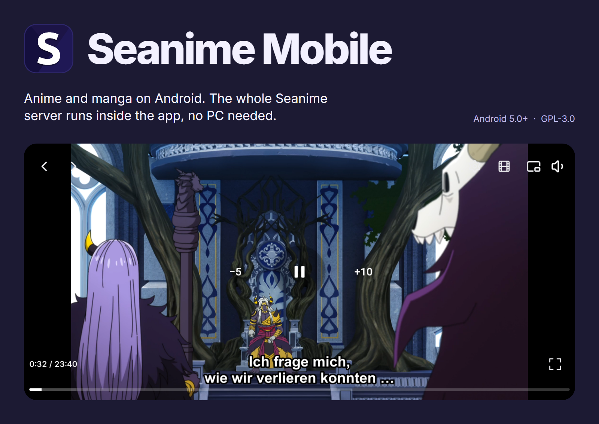
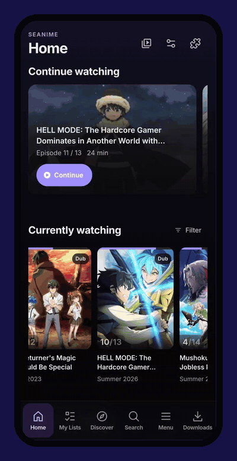
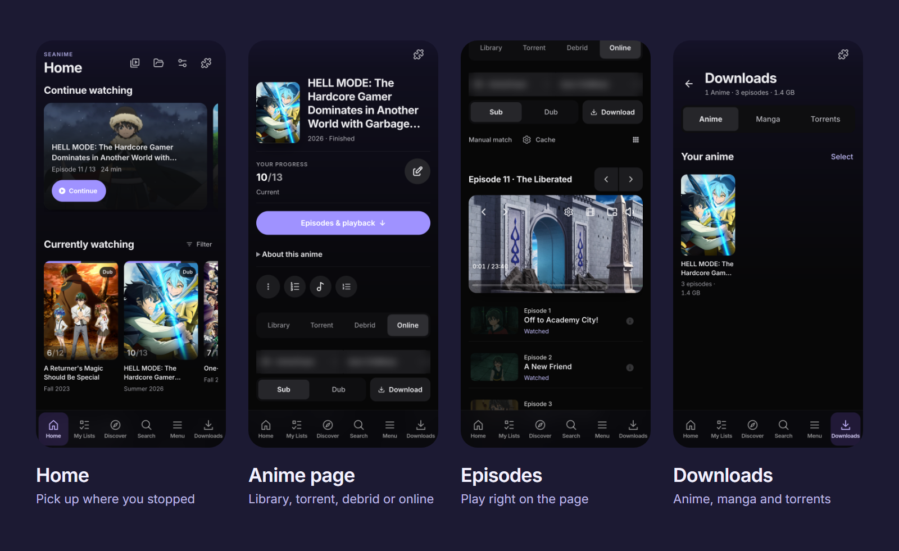
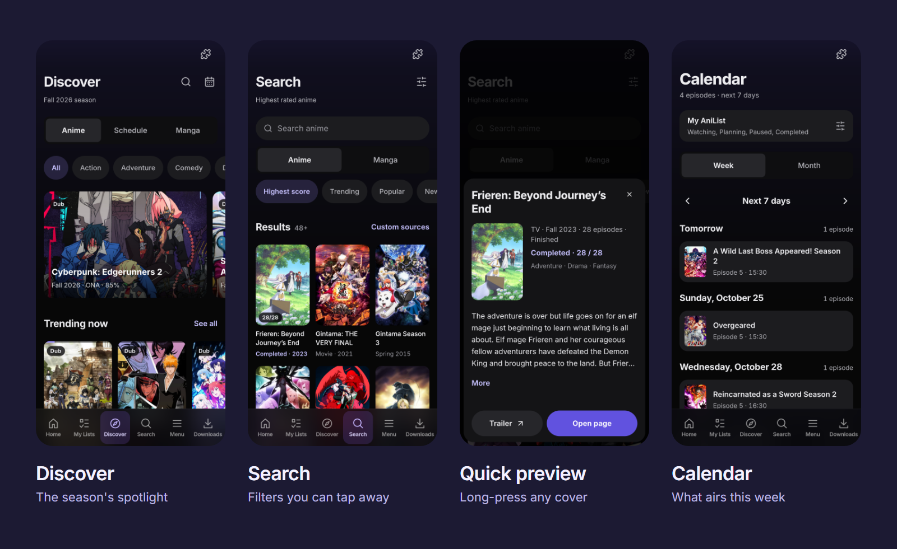
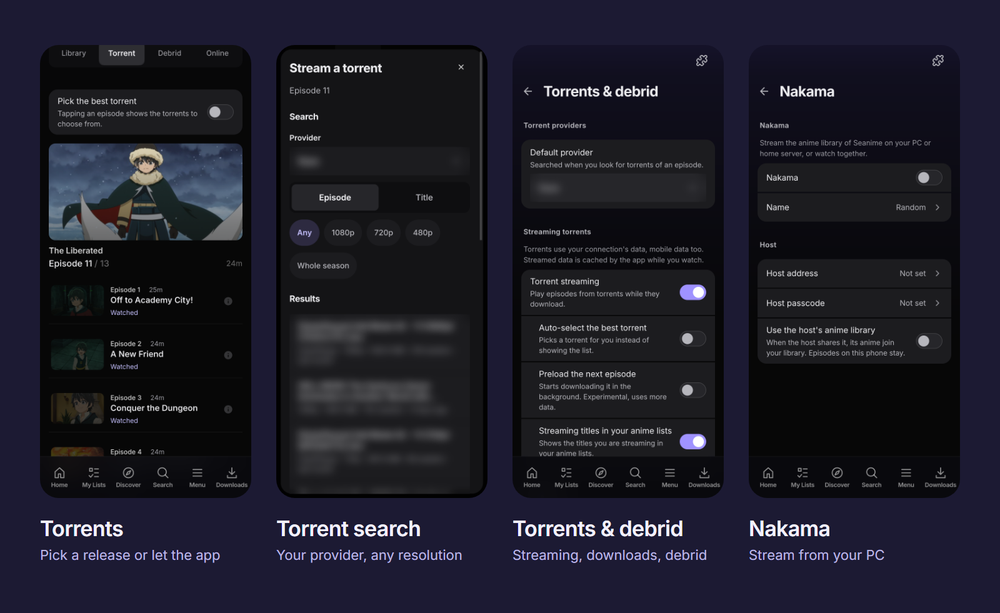
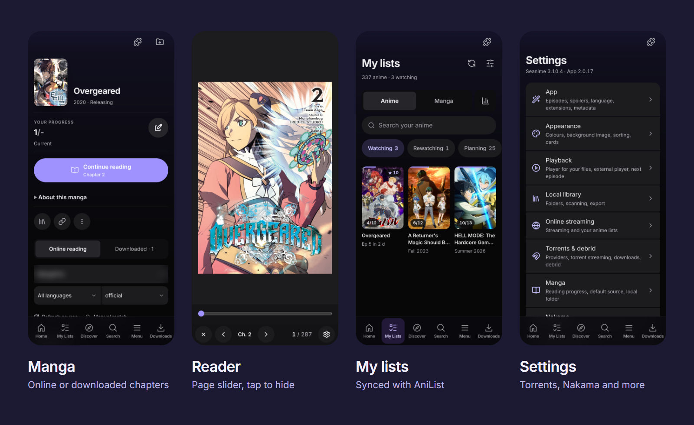

<p align="center">
  
</p>

<p align="center">
  <a href="https://github.com/Lampe332/seanime-mobile/releases/latest"></a>
  
  <a href="LICENSE"></a>
</p>

<p align="center"><a href="https://github.com/Lampe332/seanime-mobile/releases/latest"><b>Download the latest APK</b></a> &nbsp;·&nbsp; <a href="#install">Install</a> &nbsp;·&nbsp; <a href="#first-start">First start</a> &nbsp;·&nbsp; <a href="#faq">FAQ</a> &nbsp;·&nbsp; <a href="CHANGELOG.md">Changelog</a></p>

[Seanime](https://github.com/5rahim/seanime) is a server you run on a computer and open in a browser. Seanime Mobile packs that whole server into an Android app and rebuilds every screen for touch, so your phone is the only device you need. You stream anime through extensions or torrents, save whole seasons for the train, read manga, and your AniList lists stay in sync.

If you already run Seanime at home, the app can also play that library over Wi-Fi.

New versions come out often. The newest is always on the [releases page](https://github.com/Lampe332/seanime-mobile/releases/latest), and the app tells you when there is one. Tested on a Samsung Galaxy S22 Ultra.

<table>
  <tr>
    <td width="42%" align="center"></td>
    <td>
      <h3>At a glance</h3>
      <ul>
        <li>Stream with Sub or Dub, in the built-in player or in VLC, MX Player, mpv or Just Player</li>
        <li>Download a whole season and watch it offline</li>
        <li>Stream or download torrents, or stream through a debrid service</li>
        <li>Play the library of Seanime on your PC or home server</li>
        <li>Read manga online or offline</li>
        <li>AniList sync for lists, progress and scores</li>
        <li>Play your own files from folders on the phone</li>
        <li>Extensions and plugins from the Seanime ecosystem</li>
        <li>Updates itself, in English or German</li>
      </ul>
    </td>
  </tr>
</table>

## Good to know before you install

- **No sources included.** The app ships without streaming, torrent or manga sources. You add them from a community extension repository ([First start](#first-start), step 4); this project does not link to any.
- **Android on ARM only.** Android 5.0 or newer on a 64-bit or 32-bit ARM phone. There is no iOS version.
- **Not the official app.** Seanime Mobile is an independent, open-source fork of Seanime under the GPL-3.0.
- **Torrents are up to you.** They only work with torrent providers you install yourself, and they use your connection, mobile data included. The auto-downloader is not available on Android.

## What it does

### Watch and download

<p align="center"></p>

Open an anime, pick a source, a server and Sub or Dub, and it plays in the built-in player: picture-in-picture, skip opening and ending, your default audio and subtitle language, and subtitles you can translate from the player menu (Google works without a key). Would you rather use VLC, MX Player, mpv or Just Player? One tap hands the episode over.

The same page downloads a whole season or single episodes. Everything you saved sits in the **Downloads** tab and plays without a connection; episodes you started offline wait in a *Continue offline* row. **Continue watching** on Home resumes where you stopped.

### Find something new

<p align="center"></p>

Discover opens with the season's spotlight, then trending and top rows, each with *See all*. In Search, every filter shows as a chip you can tap away, and more results load as you scroll. Long-press any cover for a quick preview, playlists and plugin actions. The calendar shows what airs in the next 7 days or the whole month.

### Torrents, debrid and your home server

<p align="center"></p>

With a torrent provider installed, you can stream an episode straight into the built-in player. Search by episode or title, filter by resolution, or let the app pick the best release. The app's own torrent client downloads into your library folder: one episode, a whole season, or only the episodes you are missing. It keeps going in the background and after a restart, and **Downloads → Torrents** shows progress and speed. Debrid works with your own TorBox, Real-Debrid, AllDebrid or Premiumize account.

Don't need all of that? Under **⋮ → Tabs** on an anime page you choose which tabs (Torrent, Debrid, Online) show up.

Already run Seanime on a computer or home server? Connect the app through **Nakama** and that library joins the episodes on your phone. Nothing is copied, the app reconnects on its own when the server wakes up, and the settings show whether you are connected. ([Setup](#faq))

### Read and keep track

<p align="center"></p>

The Manga tab starts with *Continue reading*. The reader has a page slider, tap-to-hide controls, brightness, a black, gray or white background and keep-screen-on, and downloaded chapters open offline. **My lists** has search, every AniList status and your stats, and changes go straight to AniList.

### Your own files, extensions and the rest

- Pick folders with Android's folder picker; the scanner matches your files to AniList, and you can fix matches on the phone.
- Install streaming and manga sources and plugins from community repositories. Plugin windows are laid out for touch, and favourites can be pinned.
- Bottom sheets instead of desktop dialogs, the Android Back button everywhere, and a bottom bar you can rearrange.
- Settings save instantly. Options for programs a phone cannot run are hidden.

## Install

1. On your phone, open the **[latest release](https://github.com/Lampe332/seanime-mobile/releases/latest)** and download `Seanime-Mobile-x.y.z.apk` under *Assets*.
2. Open the downloaded file. The first time, Android asks you to allow **Install unknown apps** for your browser or file manager; allow it and go back.
3. Tap **Install**. The app is called *Seanime Mobile*.

> [!NOTE]
> **Play Protect** may warn you because the app does not come from the Play Store. Choose *More details → Install anyway*.

### Updates

The app checks this repository for new releases when it starts. When one is out, tap **Download and update**; the app verifies the download and Android asks you to confirm. Your data and downloads stay. Turn the check off under *Settings → About → Look for new versions*, or run it by hand with *Check for updates now*.

## First start

1. **Welcome screen.** Choose English or Deutsch, decide whether you want online streaming and manga, and tap **Start Seanime**.
2. **Permissions.** Android asks once about file access: **Allow file access** if you want to play your own files, or **Use streaming** without it. On Android 13 and newer it also asks to show notifications, for download progress and updates.
3. **Connect AniList.** Tap **Open AniList**, log in and allow Seanime, then **Paste** the token and tap **Connect**. No account? Make one for free at [anilist.co](https://anilist.co), or tap **Not now** to use a local account and sign in later from the Menu.
4. **Add sources.** The app ships **without** streaming or manga sources, and the official marketplace only has plugins. A short tour starts on its own and walks you through adding a community repository:
   1. *Menu → Extensions* → **Marketplace** tab → **Change**.
   2. Paste the repository link (an address that ends in `.json`) and tap **Save**.
   3. Install a streaming source, then a manga source. For torrents, also install a torrent provider; it then shows up under *Settings → Torrents & debrid*.

   You can run the tour again from *Settings → App → Show the setup tutorial* or the ⋮ menu on the Extensions screen. This project does not link to any sources and has nothing to do with their content.
5. **Start watching.** Open an anime, tap **Episodes & playback** and pick an episode, or tap **Download** to save it for later.

## FAQ

<details>
<summary><b>The pages say "No content yet"</b></summary>

That is expected on a fresh install. Connect AniList to see your lists and the catalog, and install a streaming or manga source to watch and read ([First start](#first-start), step 4). The pages fill up right away; no restart needed.
</details>

<details>
<summary><b>An episode won't play</b></summary>

It is almost always the source. Pick another server or source on the anime page; servers marked "not directly playable" usually fail. Keeping your extensions up to date (*Menu → Extensions*) helps too.
</details>

<details>
<summary><b>"App not installed" when updating</b></summary>

An update has to be signed with the same key as the installed app, which is true for every release here. If you installed a self-built or third-party version before, uninstall it first; its downloads go with it.
</details>

<details>
<summary><b>Where are my downloads stored?</b></summary>

Episodes from streaming sources live in the app's private storage. You find them in the **Downloads** tab, and Android deletes them when you uninstall the app. Torrent downloads go into your library folder (*Settings → Library*) and stay there; they show under **Downloads → Torrents** and in your library.
</details>

<details>
<summary><b>How do I stream from my PC or home server?</b></summary>

1. On the computer or server, open Seanime → *Settings → Nakama*: **Enable Nakama**, **Enable host mode**, set a **Passcode** and turn on **Share local anime library**.
2. In the app, open *Settings → Nakama*: turn **Nakama** on, enter the **Host address** (the computer's IP address and port, like `192.168.1.20:43211`) and the **Host passcode**, and turn on **Use the host's anime library**.
3. The row below says **Connected to …**, and the server's anime appear in your library. Open one and tap an episode.

Phone and computer need to be on the same network, unless you make the server reachable from outside, for example through a VPN like Tailscale.
</details>

<details>
<summary><b>Can I switch the language?</b></summary>

Yes: *Settings → App → Language* switches between English and German.
</details>

Found a bug or have an idea? [Open an issue](https://github.com/Lampe332/seanime-mobile/issues) with your phone model, Android version and app version (*Settings → About*).

## Build it yourself

The repository holds the complete source: the Android app (Kotlin), the Seanime server (Go) and the interface (React). Step-by-step instructions are in **[docs/BUILD.md](docs/BUILD.md)**.

```
app/            Android app: Kotlin, WebView, player, downloads, updater
backend/        Seanime server (Go) and the web interface (backend/seanime-web, React)
docs/           Build guide, README images, upstream documentation, development notes
tests/          Phone UI tests (Python and Playwright)
Build.ps1       Full release build including the backend
```

## Credits and license

- [**Seanime**](https://github.com/5rahim/seanime) by 5rahim: server and web interface
- [**Seanime Android**](https://github.com/Pal-droid/Seanime-Android) by Pal-droid: the original Android port ([original README](docs/upstream/README.md))

Seanime Mobile is licensed under the **GPL-3.0**, like the projects it builds on ([LICENSE](LICENSE)). The app hosts no content; it only shows what your installed extensions provide.
