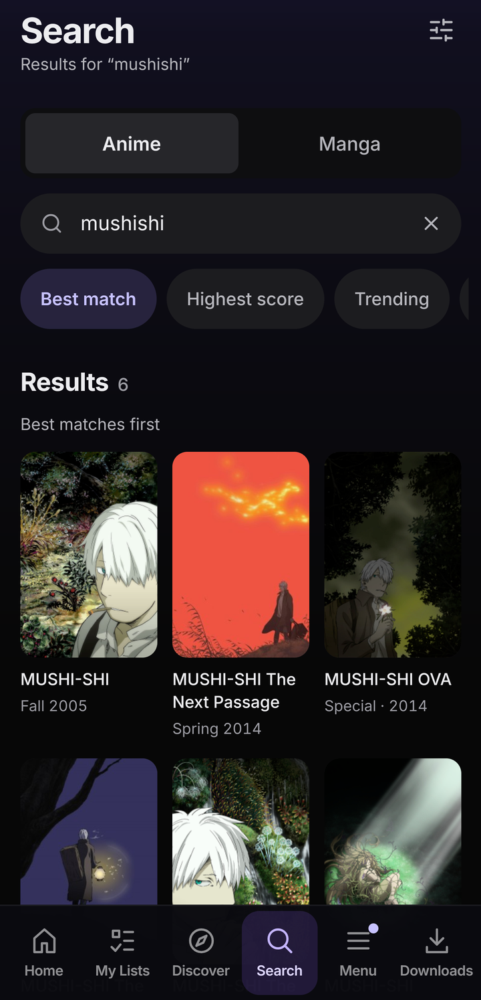
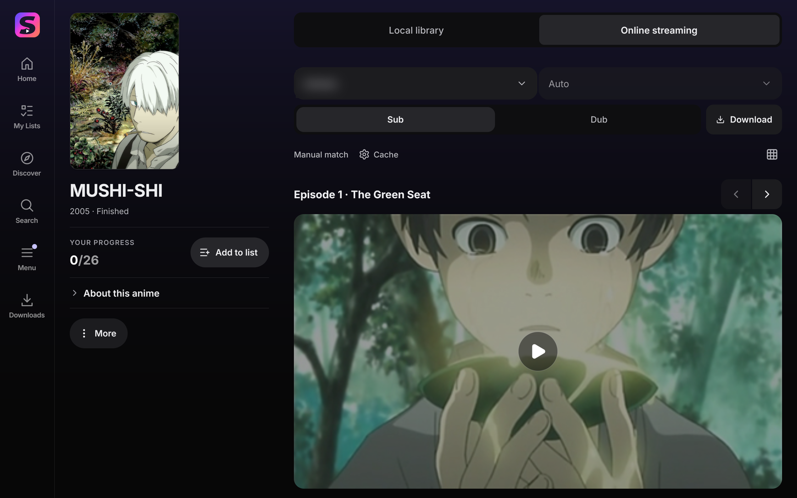
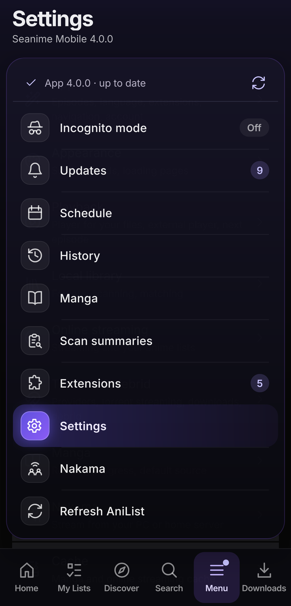
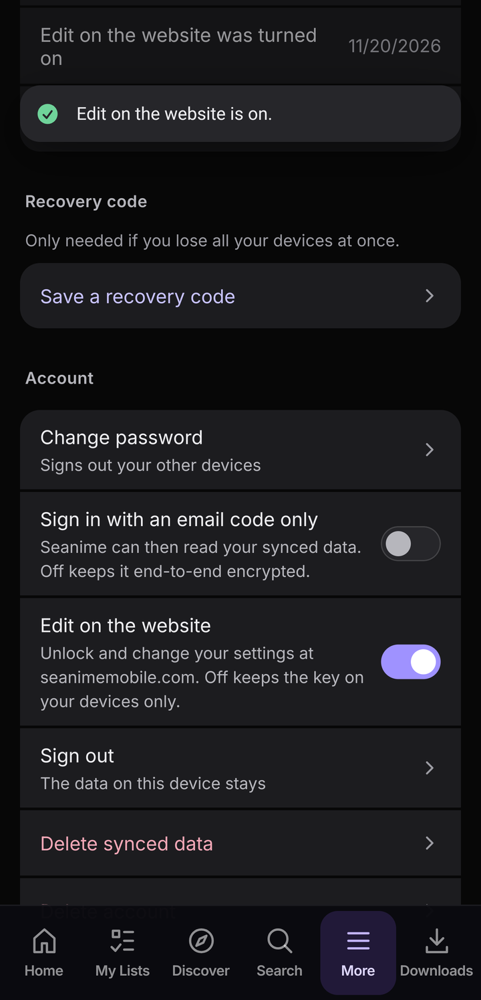
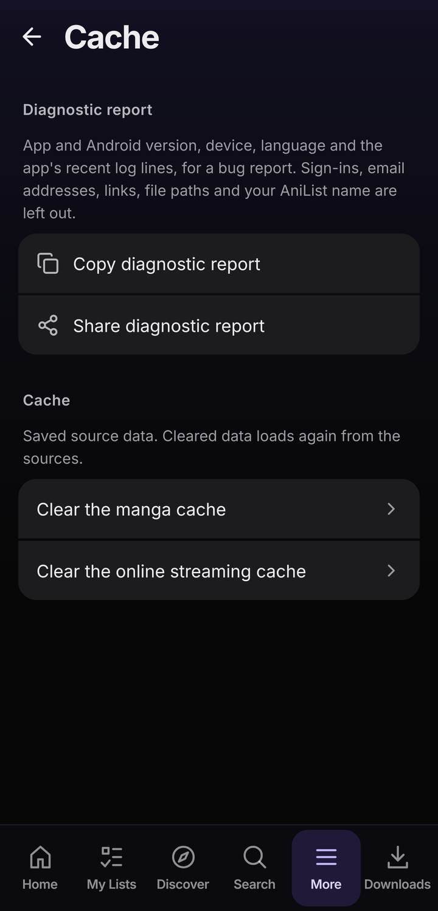

  

<h1 align="center">Seanime Mobile</h1>

  <b>Anime and manga on your Android phone or tablet.</b> 
  Stream or download episodes, read manga, and keep your AniList in sync. 
  Free, open source, no ads. No PC and no server at home.

  
  &nbsp;
  

  
  
  

  <a href="https://seanimemobile.com">Website</a> &nbsp;·&nbsp;
  <a href="#install">Install</a> &nbsp;·&nbsp;
  <a href="#first-start">First start</a> &nbsp;·&nbsp;
  <a href="#account-and-sync">Account</a> &nbsp;·&nbsp;
  <a href="#faq">FAQ</a> &nbsp;·&nbsp;
  <a href="https://discord.gg/dxJdj5Dqt9">Discord</a> &nbsp;·&nbsp;
  <a href="CHANGELOG.md">Changelog</a>

Unofficial · built on <a href="https://github.com/5rahim/seanime">Seanime</a> by 5rahim. Not the official Seanime app.

  

## Why use it

- **Everything runs on the device.** The app has its own core, so there is no PC or home server to keep alive.
- **No account required.** Log in with AniList, or use a local account that keeps your lists on the phone. A Seanime account that syncs your devices is optional, and its data is end-to-end encrypted.
- **No ads, no price tag.** It's free software under the GPL-3.0, and the code is right here.
- **One APK for phones and tablets.** Tablets get a layout of their own.
- **Eight languages.** English, German, Spanish, Russian, Simplified Chinese, Brazilian Portuguese, French and Japanese.

  
  
  
  

Version 4.0 on a Galaxy S22 Ultra and a Pixel Tablet.

## What it does

<table>
  <tr><td><b>Watch</b></td><td>Stream from the sources you install, online or by torrent, with Sub or Dub. The player is mpv, so AC3, DTS, ASS subtitles and every track of an MKV just play. Torrent results are cards with group, resolution, seeders and codec, and <i>Best match</i> marks the one auto select would pick.</td></tr>
  <tr><td><b>Download</b></td><td>Keep episodes and chapters on the device for when there's no connection. Torrents download too, with speed limits, a queue and a choice of single files from a batch.</td></tr>
  <tr><td><b>Read</b></td><td>Manga, online or offline, as a long strip, page by page, or two pages side by side. The Manga tab picks up where you stopped.</td></tr>
  <tr><td><b>Track</b></td><td>Your AniList lists and progress stay in sync. If AniList is down, or stops accepting your sign-in, your changes wait on the phone and go out later.</td></tr>
  <tr><td><b>Sync</b></td><td>An optional Seanime account keeps settings, watch positions, history, playlists and extensions the same on all your devices. Your devices encrypt everything before it is uploaded. If you want, you can also change your synced settings on the website. <a href="#account-and-sync">How it works</a>.</td></tr>
  <tr><td><b>Cast</b></td><td>Send an episode to your TV over DLNA, or play your PC's Seanime library through Nakama.</td></tr>
  <tr><td><b>Tablets</b></td><td>A navigation rail, settings in two panes, and anime pages where the cover stays put while the episodes scroll.</td></tr>
</table>

The smaller things

 

- The app can fetch the next one to three episodes of what you're watching on its own (Wi-Fi only), and delete the ones you've watched. Both are off until you switch them on.
- The bottom bar has five entries: Home, My Lists, Discover, Downloads and More. Search is a button on Home and Discover and also sits in More, which opens with your AniList profile and your Seanime account. A bar you customized before 4.2.0 stays as it is; *Settings → App → Reset navigation* gives you the new one.
- *More → History* lists what you watched and read, day by day.
- *More → Updates* gathers new episodes and chapters since your last visit. The app can also notify you when a manga on your list gets a new chapter.
- Pull down on My lists, Updates, Schedule and History to load them again.
- Incognito mode pauses the history and the automatic progress updates. An episode you mark yourself still goes to AniList.
- There's a *Continue watching* widget for your home screen. Add it from *Settings → App*.
- *Settings → App → Backup* writes settings, watch positions, playlists, extensions and the local account's lists into one file. Restore shows what the file holds before it changes anything, and you can undo the last restore. Tokens and passwords never go into the file.
- Long-press a cover for quick actions: add to list, +1 episode or chapter, continue reading.
- Torrent downloads show percent, speed and time left in the notification, and you get a notice when one finishes or fails. A download that doesn't fit into your free storage is refused before it starts, with the numbers.
- While a torrent stream loads, the player shows the stage, the loaded share, speed, peers and seeders. With no seeders you can pick another torrent right away.
- *Keep in library* in the player menu keeps a streamed torrent as a download instead of deleting it when the player closes.
- *Settings → Torrents & debrid* has *Preload the next episode* (it never slows the running stream and never uses mobile data), download and upload speed limits, a download queue and *Stop sharing when finished*. Auto select can prefer the larger file.
- In the torrent search, filters fold away so the results come first, and the sort *Largest* puts the biggest releases first. Copy a result's magnet link with the copy button or a long press.
- The app reads group, resolution, season and similar details from the release name when the provider leaves them out.
- After an episode played in an external player such as VLC, the app asks *Mark episode N as watched?* It only asks with *Update progress automatically* on and after at least 60 seconds in the other app.
- *Settings → Cache → Diagnostic report* copies or shares a report for a bug report: app and Android version, device, language and recent log lines. Sign-ins, email addresses, links, file paths and your AniList name are left out.
- On Android 13 and newer you can also pick the app's language in Android's settings (*Apps → Seanime Mobile → Language*). The app and Android stay in step.
- Double-page mode in the manga reader pairs pages in the right order for both reading directions. Wide spreads stand alone, and *Page offset* moves the pairs. On a tablet, *Automatic* shows two pages in landscape and one in portrait.
- The *Support on Ko-fi* link is in *Settings → About* and at the bottom of *More*.

More screenshots

 

  

  
  
  

  
  

Want a guided look first? The [website](https://seanimemobile.com) has a tap-through tour of the app and the full feature list.

## See it run

  

Recorded with version 3.0. Most screens still look like this; some details have changed since, such as the bottom bar and the menu.

## Install

1. On your phone or tablet, open the [latest release](https://github.com/Lampe332/seanime-mobile/releases/latest) and download the `Seanime-Mobile` APK under *Assets*. It's about 71 MB.
2. Open the file. The first time, Android asks you to allow *Install unknown apps* for your browser or file manager. Allow it and go back.
3. Tap *Install*. Play Protect may warn you because the app doesn't come from the Play Store. Choose *More details → Install anyway*.

Stuck on one of those steps? [seanimemobile.com/help](https://seanimemobile.com/help) walks through them one by one, shows how to check the file's SHA-256 checksum, and lists fixes for common problems.

From then on the app offers updates itself. It checks this repository for a new release when it starts, and it installs a download only when it matches the checksum GitHub publishes for it.

> [!IMPORTANT]
> **Still on 2.0.33?** Its updater refuses 4.0 with "APK does not support this device". Download the APK by hand and install it over the old app. Your data stays, and downloaded episodes, chapters and installed extensions are taken over on the first start. From 3.0.0 the update arrives in the app as usual.

## First start

1. Pick your language and tap *Get started*. The app speaks English, German, Spanish, Russian, Simplified Chinese, Brazilian Portuguese, French and Japanese. It follows the phone's language, and you can change it later under *Settings → App → Language*, or on Android 13 and newer in Android's own app language settings.
2. Log in with AniList. Allow access there and copy the code it shows. Back in the app, it finds the code and offers *Connect*. No account? Make one for free at [anilist.co](https://anilist.co), or tap *Not now* and use the local account.
3. Add sources. None are installed at first. A short tour shows the way: *More → Extensions → Marketplace*. The official Seanime marketplace by 5rahim is set by default, but right now it has no streaming or manga sources. For those, add a community marketplace: paste its link, check the preview, add it. The [setup guide on the website](https://seanimemobile.com/#start) has one ready to copy. Then install a streaming source and a manga source.

This project has nothing to do with the content of extensions. Community extensions get scanned automatically, but nobody checks them by hand, so only install what you trust.

## Good to know

It runs on 64-bit and 32-bit ARM devices with Android 7.0 or newer. There is no iOS version.

Torrents only work with torrent providers you install, and they use your connection, mobile data included. The app asks before a torrent starts on mobile data.

Not everything is tested on real hardware. Debrid isn't yet. Nakama was tested as a guest of Seanime on a PC (library and playback), and casting over DLNA on an LG TV, without checking subtitles on the TV.

What 4.0 no longer has

 

Some features needed the built-in server of the older versions and did not come back: plugins, Discord status, Nakama watch parties and cloud rooms, filler marking, custom source lists, debrid downloads into a folder, following the progress inside external players (since 4.3.0 the app asks afterwards instead), searching other manga sources and local manga. The double-page reader view is back since 4.3.0. *Export library data* is gone too; Backup replaces it.

## Account and sync

The account is optional. Without one, the app works as it always did and talks to no account server. With one, your settings, watch positions, history, playlists, extensions and their settings, and the keys you saved (AniList token, debrid key, Nakama password) stay the same on all your phones and tablets. Downloads, a device's own keys and the changes still waiting for AniList stay on each device. Your AniList lists stay at AniList.

Create an account under *Settings → Account* or from the profile head at the top of *More*: an email address and a password of at least 10 characters, then confirm the address from the mail within 7 days. The setup tour has a card for it; after an update from 4.1.0 you see only that card, once. Sync runs every 5 minutes while the app is open, when you start or leave it, and on *Sync now*.

**What the server sees.** Your devices encrypt everything with a key before it is uploaded (libsodium: XChaCha20-Poly1305, X25519, Argon2id). The server at `api.seanimemobile.com`, a Cloudflare Worker with a D1 database and R2 storage, holds one sealed package of at most 10 MB per account. It sees your email address, your device names and public keys, the size of the package and when it changed. It does not see the content, your password or the data key. The app turns your password into a login key with Argon2id and sends only that, and the server stores a keyed hash of it. The server code is in [`account-server/`](account-server/), and the [privacy page](https://seanimemobile.com/privacy#account) lists what it stores and for how long.

**Devices.** *Settings → Account* lists every device with the time it was last seen, plus security events, each of which is also mailed to you. *Change encryption key* lets you pick the devices that keep access and removes all others, so a lost phone can't read anything new. With your password, a new device normally unlocks your data by itself. Without it, an already signed-in device has to approve the new one: both show the same 6-digit number, and *No* on either side ends the request.

**Sign in with a code.** On the sign-in form, *Sign in with a code instead* mails you a 6-digit code that works once for 10 minutes. By default the code proves your mailbox, not your key. The device is signed in with its data locked, and it unlocks through an approval on another device, a recovery code or *Start fresh*, which deletes the synced data in the account. Right after a code sign-in you can set a new password without the old one, for 15 minutes.

**Code-only sign-in is opt-in.** *Sign in with an email code only* in *Settings → Account* is off by default and asks for your password. When it is on, the server keeps a sealed copy of your data key so that a mailed code alone is enough to get everything on a new device. That means the server can read your synced data while it is on, and so can anyone who gets into your mailbox. Turning it off deletes the server's copy at once, and both changes are mailed to you.

**Edit on the website is opt-in.** With *Settings → Account → Edit on the website* turned on (the app asks for your password), you can unlock your synced settings at [seanimemobile.com/account](https://seanimemobile.com/account/) with your password or recovery code, change them and save. Your devices pick the change up at their next sync. While unlocked, the browser holds your data key in memory only, and it locks itself after 5 minutes without input or 2 minutes in another tab. Every unlock is mailed to you. Extension files, history and playlists stay in the app, and stored secrets are never shown. Turning the switch off, in the app or on the website, locks every browser at once. The [step-by-step guide](https://seanimemobile.com/docs/account#web-edit) has screenshots.

**The account page on the website.** [seanimemobile.com/account](https://seanimemobile.com/account/) lists your [sessions](https://seanimemobile.com/docs/account#sessions), app and website, so you can sign out one or all others, and the security events with a filter for sign-ins. It never stores IP addresses. Security events in the app and on the website name sign-ins, password resets, confirmed addresses, signed-out sessions and website unlocks in plain words.

**Recovery code.** A recovery code is 26 characters you keep on paper or in a password manager. You only need it if all your devices are gone at once. Make one under *Settings → Account → Save a recovery code*. Removing a device makes it stop working, and the app asks for a new one. Forgot your password? *Forgot password* on the sign-in form opens the reset page of the website. Without a signed-in device and without a recovery code, synced data can't be opened by anyone, and you start fresh.

What this does not protect against, and the rest of the design, is written down on the [Account & sync page](https://seanimemobile.com/docs/account) of the website.

## If you know Seanime

Seanime Mobile started as a fork of [Seanime](https://github.com/5rahim/seanime), 5rahim's media server for anime and manga. Up to 3.0 the APK carried that whole server and ran it in the background. Since 4.0 the server is gone and the app runs on its own core, written in TypeScript, with a few native modules for torrents, casting and extensions. The download shrank from about 107 MB to about 71 MB, and Home shows your lists right after start.

What stayed: the screens are derived from Seanime's web interface, and extensions use Seanime's format. You don't need Seanime on a PC. If you have it anyway, Nakama plays its library on your phone.

The one server in the picture is the optional account server from [Account and sync](#account-and-sync). The app never needs it to run.

This is not the official app. That one is [Tenji](https://seanime.app/docs/tenji), a client for a Seanime server on your computer or on the phone. If you prefer the official route, use Tenji.

## FAQ

The pages say "No content yet"

 

Normal on a fresh install. Connect AniList to see your lists and the catalog, and install a streaming or manga source to watch and read ([First start](#first-start), step 3).

An episode won't play

 

It's almost always the source. Pick another server or source on the anime page, and keep your extensions up to date (*More → Extensions*).

"App not installed" when updating

 

An update has to be signed with the same key as the installed app, and every release here is. If you installed a self-built or third-party version before, uninstall it first; its downloads go with it.

Do I need an AniList account?

 

No. The local account keeps lists and progress on the device, and *Upload local lists* moves them to AniList if you sign in later.

Do I need a Seanime account? Can its server read my data?

 

No, the account is optional and only adds sync between your devices. Its data is end-to-end encrypted, so the server can't read it. The one exception is the opt-in *Sign in with an email code only* setting: while it is on, the server holds a copy of your key and can read your synced data. It is off by default. Details are in [Account and sync](#account-and-sync).

Where do I find more help, and what does the app send where?

 

[seanimemobile.com/help](https://seanimemobile.com/help) covers installing, checking the file, updates and common problems. The [privacy page](https://seanimemobile.com/privacy) explains what the app sends where and which permissions it uses for what.

Found a bug or have an idea? [Open an issue](https://github.com/Lampe332/seanime-mobile/issues) and paste the diagnostic report from *Settings → Cache*. It already names your device model, Android version and app version. For questions, help with setup or just to chat, join the [Discord server](https://discord.gg/dxJdj5Dqt9).

## Support

Seanime Mobile is free and stays free: no ads, no paywalled features. I build it in my spare time, so if the app is useful to you and you'd like to say thanks, you can buy me a coffee on Ko-fi. It's completely optional, and a bug report or a star helps too. The same link is in the app under *Settings → About* and at the bottom of *More*.

## Build it yourself

The app lives in `native/`: React Native and Expo in TypeScript, the core in `native/src/core/`, the native modules in `native/modules/`. Build instructions are in [docs/BUILD.md](docs/BUILD.md). The optional account server, a Cloudflare Worker, lives in [`account-server/`](account-server/).

## Credits and license

Seanime Mobile is built on [**Seanime**](https://github.com/5rahim/seanime) by **5rahim**, licensed under the GPL-3.0. It started as a fork of Seanime and now runs its own core; the screens are derived from Seanime's web interface (seanime-web), and the extension format and contract are Seanime's. Seanime Mobile is not affiliated with Seanime or 5rahim.

- [Seanime Android](https://github.com/Pal-droid/Seanime-Android) by Pal-droid: the original Android port ([original README](docs/upstream/README.md))
- [mpv](https://mpv.io) through [expo-mpv](https://www.npmjs.com/package/expo-mpv): the player
- [libtorrent](https://www.libtorrent.org) (BSD-3-Clause), [BoringSSL](https://boringssl.googlesource.com/boringssl), [Boost](https://www.boost.org) (Boost Software License 1.0), [quickjs-ng](https://github.com/quickjs-ng/quickjs) (MIT) and [libsodium](https://libsodium.org) (ISC) in the native modules

The full license texts of these and the bundled JavaScript libraries are in [`licenses/`](licenses/). The old server code and the earlier apps are still in the git history.

Seanime Mobile is licensed under the GPL-3.0 ([LICENSE](LICENSE)). The app hosts no content; it only shows what your installed extensions provide.

## Legal

Nick Schäfer · Kanton Basel-Landschaft, Switzerland · info@seanimemobile.com

- Website: [seanimemobile.com](https://seanimemobile.com)
- Privacy policy: [seanimemobile.com/privacy](https://seanimemobile.com/privacy)
- Imprint: [seanimemobile.com/imprint](https://seanimemobile.com/imprint)

Unofficial app, built on Seanime by 5rahim. No telemetry, no analytics. The same details are in the app under *Settings → About → Legal*. The Discord link is in *Settings → About* too.

Website: <a href="https://seanimemobile.com">seanimemobile.com</a> · <a href="https://seanimemobile.com/help">Help</a> · <a href="https://discord.gg/dxJdj5Dqt9">Discord</a> · <a href="https://seanimemobile.com/privacy">Privacy</a> · <a href="https://seanimemobile.com/security">Security</a> · <a href="https://seanimemobile.com/imprint">Imprint</a>

