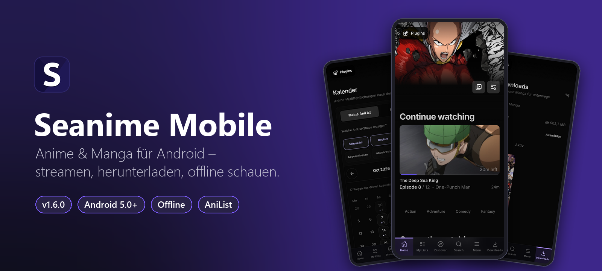
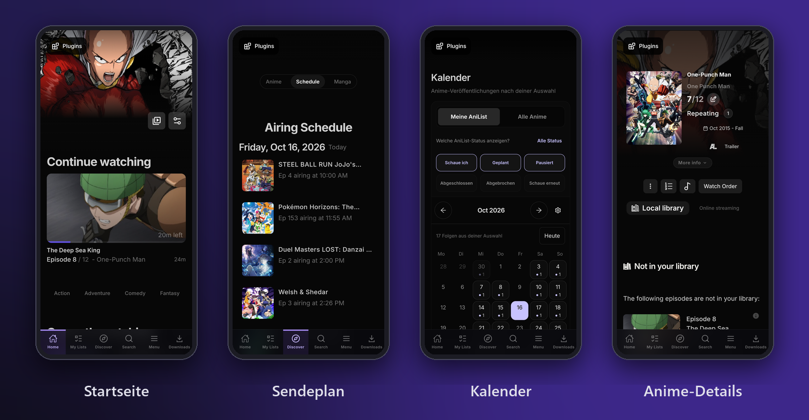
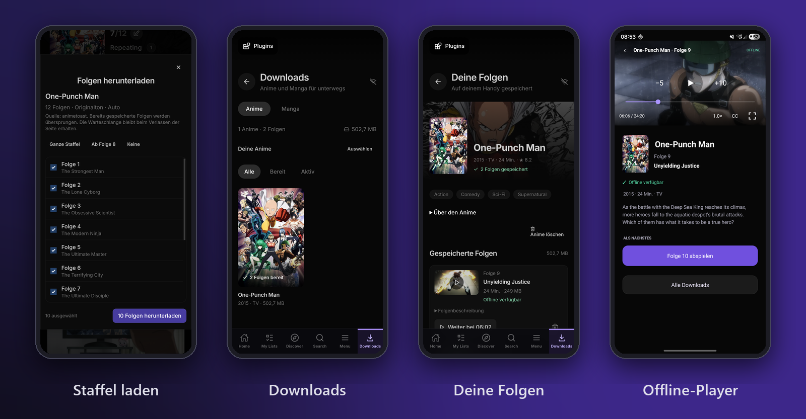
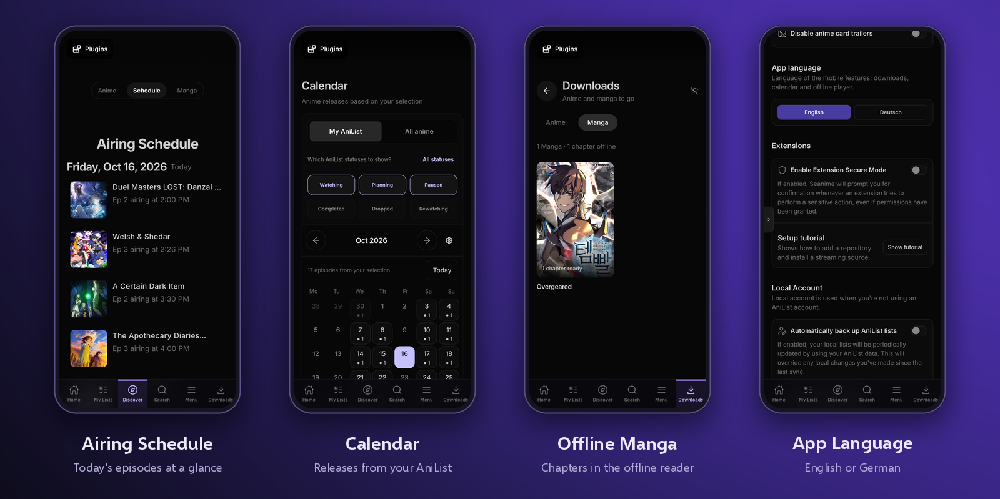

<p align="center">
  
</p>

<p align="center">
  <a href="https://github.com/Lampe332/seanime-mobile/releases/latest"></a>
  <a href="https://github.com/Lampe332/seanime-mobile/releases/latest"></a>
  
  <a href="LICENSE"></a>
</p>

<p align="center">
  <a href="https://github.com/Lampe332/seanime-mobile/releases/latest/download/Seanime-Mobile-1.6.0.apk"><b>⬇️ APK herunterladen</b></a>
  &nbsp;·&nbsp; <a href="#-installation-auf-dem-handy">Installation</a>
  &nbsp;·&nbsp; <a href="#-erste-einrichtung">Einrichtung</a>
  &nbsp;·&nbsp; <a href="docs/BUILD.md">Selbst bauen</a>
  &nbsp;·&nbsp; <a href="CHANGELOG.md">Changelog</a>
</p>

---

**Seanime Mobile** bringt [Seanime](https://github.com/5rahim/seanime) komplett aufs Android-Handy: Der Seanime-Server läuft direkt auf dem Gerät, die Oberfläche ist für Touch angepasst. Kein PC, kein eigener Server nötig. Anime streamen, ganze Staffeln herunterladen und unterwegs offline schauen. Dazu kommen Manga, AniList-Sync und ein Veröffentlichungskalender.

## ✨ Funktionen

| Funktion | Beschreibung |
|---|---|
| 📺 **Streamen** | Anime über Online-Streaming-Erweiterungen direkt in der App schauen |
| ⬇️ **Staffel-Downloads** | Ganze Staffel, „ab Folge …“ oder einzelne Folgen herunterladen, mit Warteschlange, die einen App-Neustart übersteht |
| ✈️ **Offline schauen** | Eigener Offline-Player mit Vollbild, −5/+10 s, Tempo, Untertiteln und Fortsetzen; Cover und Infos bleiben offline sichtbar |
| 📚 **Manga** | Kapitel lesen und herunterladen, offline im Reader öffnen |
| 📅 **Kalender** | Monatskalender mit allen Folgen deiner AniList-Liste oder aller Anime, filterbar nach Status |
| 🔄 **AniList** | Listen, Fortschritt und Bewertungen werden mit AniList synchronisiert |
| 🧩 **Erweiterungen & Plugins** | Quellen und Plugins aus dem Seanime-Ökosystem |

## 📱 Screenshots

<p align="center"></p>
<p align="center"></p>
<p align="center"></p>

## 📲 Installation auf dem Handy

1. Auf dem Handy die neueste **[Seanime-Mobile-APK](https://github.com/Lampe332/seanime-mobile/releases/latest)** öffnen und unter *Assets* die `.apk` herunterladen.
2. Die heruntergeladene Datei antippen (Benachrichtigung oder *Eigene Dateien → Downloads*).
3. Android fragt beim ersten Mal nach der Berechtigung **„Unbekannte Apps installieren“**. Für den Browser bzw. Dateimanager erlauben und zurückgehen.
4. **Installieren** tippen. Fertig: Die App heißt *Seanime Mobile*.

> **Update:** Neue APK einfach drüber installieren, Daten und Downloads bleiben erhalten.
> **Play Protect** warnt eventuell, weil die App nicht aus dem Play Store kommt. *Trotzdem installieren* wählen.

Unterstützt: Android 5.0 oder neuer, ARM64 und ARMv7 (praktisch alle Handys der letzten Jahre). Getestet auf Samsung Galaxy S22 Ultra.

## 🚀 Erste Einrichtung

1. **App öffnen.** Beim ersten Start fragt Android nach Benachrichtigungen (für Download-Fortschritt) und Dateizugriff. Beides erlauben.
2. **Mit AniList anmelden.** Auf dem Startbildschirm **Log in with AniList** tippen und im Browser bestätigen. Ein kostenloses Konto gibt es auf [anilist.co](https://anilist.co). Danach erscheinen deine Listen unter *My Lists* und *Continue watching*.
3. **Quellen hinzufügen.** *Menu → Extensions* öffnen und Online-Streaming- bzw. Manga-Erweiterungen installieren. Ohne Erweiterung kann die App Anime nur anzeigen, nicht abspielen.
4. **Loslegen.** Anime antippen → *Online streaming* zum Schauen oder *Staffel / Folgen herunterladen* für offline. Gespeichertes findest du unten im Tab **Downloads**.

## ❓ Häufige Fragen

<details>
<summary><b>„App nicht installiert“ beim Update</b></summary>

Die neue APK muss mit demselben Schlüssel signiert sein wie die installierte. Das ist bei allen offiziellen Releases hier der Fall. Wenn du vorher eine selbst gebaute oder fremde Version installiert hattest, die alte App zuerst deinstallieren (dabei gehen lokale Downloads verloren).
</details>

<details>
<summary><b>Eine Folge spielt nicht ab</b></summary>

Meist liegt es an der Quelle. Im Player bzw. auf der Animeseite eine andere Erweiterung wählen oder unter *Menu → Extensions* die Erweiterungen aktualisieren.
</details>

<details>
<summary><b>Gibt es Torrents?</b></summary>

Nein. Torrent- und Debrid-Funktionen sind in der Android-Version bewusst deaktiviert. Downloads laufen über direkte MP4-/HLS-Quellen.
</details>

<details>
<summary><b>Wo liegen meine Downloads?</b></summary>

Im privaten App-Speicher. Sie sind nur in der App unter *Downloads* sichtbar und werden beim Deinstallieren gelöscht.
</details>

## 🛠️ Selbst bauen

Das Repository enthält den kompletten Quellcode: Android-App (Kotlin), Seanime-Backend (Go) und Oberfläche (React). Die Schritt-für-Schritt-Anleitung steht in **[docs/BUILD.md](docs/BUILD.md)**.

```
app/            Android-App (Kotlin, WebView, Offline-Player, Download-Dienst)
backend/        Seanime-Server (Go) + Weboberfläche (backend/seanime-web, React)
docs/           Bau-Anleitung, Bilder, Upstream-Doku, Entwicklungsnotizen
tests/          Navigations- und Plugin-Tests (Python/Playwright)
Build.ps1       Kompletter Release-Build inkl. Backend
```

## 🙏 Credits & Lizenz

- [**Seanime**](https://github.com/5rahim/seanime) von 5rahim: Backend und Weboberfläche
- [**Seanime Android**](https://github.com/Pal-droid/Seanime-Android) von Pal-droid: ursprüngliche Android-Portierung ([Original-README](docs/upstream/README.md))

Seanime Mobile ist ein unabhängiger Fork und steht wie das Original unter der **GPL-3.0** ([LICENSE](LICENSE)). Diese App hostet keine Inhalte; sie zeigt nur an, was installierte Erweiterungen liefern.
