# Setup guide

New to Seanime Mobile? Do these steps in order and you'll be watching in about five minutes. Every step says exactly what to tap.

**You need** an Android phone or tablet with Android 7.0 or newer. iPhones and iPads won't work. There's no iOS version, so there's no .ipa file either.

Stuck? Ask in the [Discord](https://discord.gg/dxJdj5Dqt9) (channel `#help`) with the step number and what you see on screen. A screenshot helps a lot.

## Step 1: Download and install

1. On your phone, open the [latest release](https://github.com/Lampe332/seanime-mobile/releases/latest).
2. Under **Assets**, tap the **Seanime-Mobile** file that ends in **.apk** (about 74 MB).
3. When the download is done, open it from your notifications or your Downloads folder.
4. The first time, Android asks if your browser or file manager may install unknown apps. Allow it and go back.
5. Tap **Install**.
6. Play Protect may warn you because the app isn't from the Play Store. Tap **More details**, then **Install anyway**. If it asks to send the app for a security scan, **Don't send** is fine.
7. Tap **Open**.

Something went wrong here? [seanimemobile.com/help](https://seanimemobile.com/help) goes through these steps one by one and shows how to check the file's checksum.

## Step 2: First start

1. Pick your language and tap **Get started**.
2. The app asks you to connect AniList.
   - Got an account? Tap **Log in with AniList**, allow access on AniList and copy the code it shows. Back in the app it finds the code and offers **Connect**. Tap it and your lists show up. No account yet? It's free at [anilist.co](https://anilist.co).
   - Don't want AniList? Tap **Not now**. You get a local account and your lists stay on the phone. You can sign in later and upload them.
3. Home looks empty. That's normal. The app ships without any sources and you add them next.

The tabs at the bottom are **Home**, **My Lists**, **Discover**, **Search**, **More** and **Downloads**.

## Step 3: Add the community marketplace

Sources are small extensions that tell the app where to find episodes and chapters. The official Seanime marketplace is set by default, but right now it has no streaming or manga sources. You get those from the community marketplace by Bas1874.

1. Copy this link:
   ```
   https://raw.githubusercontent.com/Bas1874/Seanime-Marketplace/main/Marketplace/Main.json
   ```
2. In the app tap **More**, then **Extensions**.

   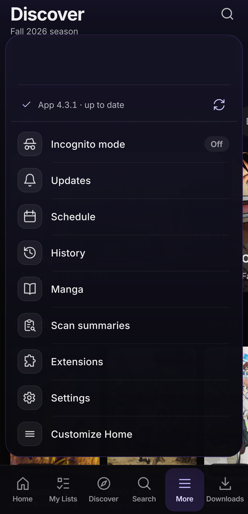

3. Open the **Marketplace** tab and tap **Add marketplace**. If you already switched once, the button says **Change**.
4. Tap **Paste link**, check the preview, then tap **Add**.

   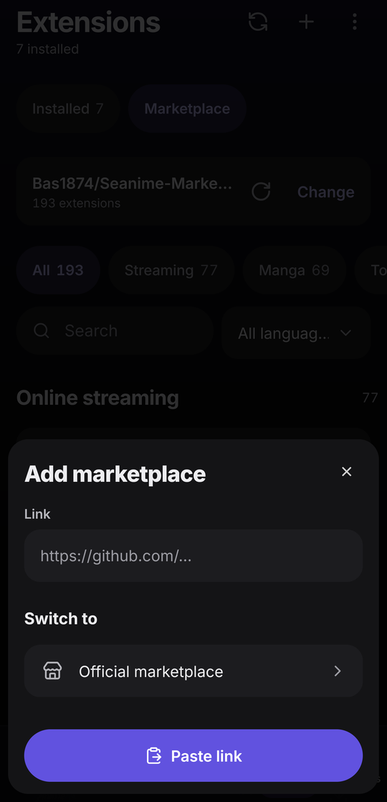

Community extensions get scanned automatically, but nobody checks them by hand. Only install what you trust. Want the official marketplace back? Tap **Change** and pick **Official marketplace** under **Switch to**.

## Step 4: Install a streaming and a manga source

1. Still in **Extensions → Marketplace**, tap the **Streaming** chip at the top.

   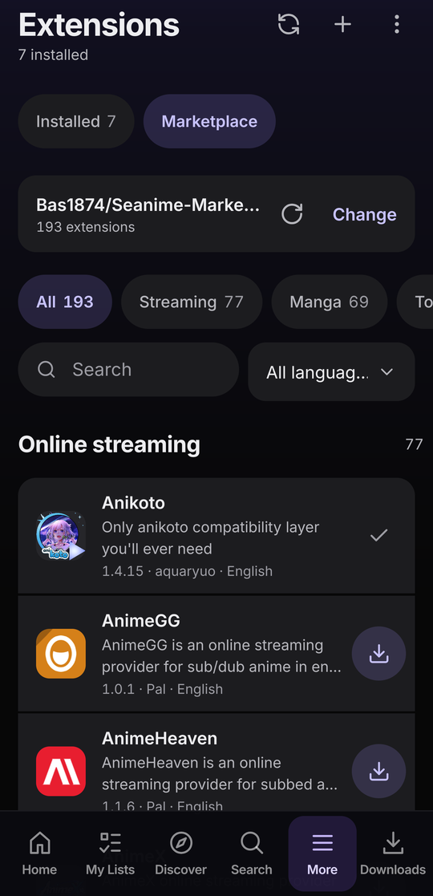

2. Tap a source, then **Install**.

   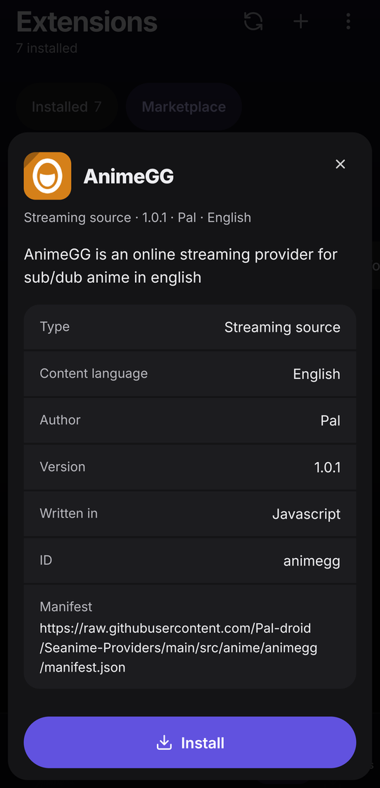

3. Tap the **Manga** chip and install one manga source the same way.
4. Switch to the **Installed** tab and check that both are there.

   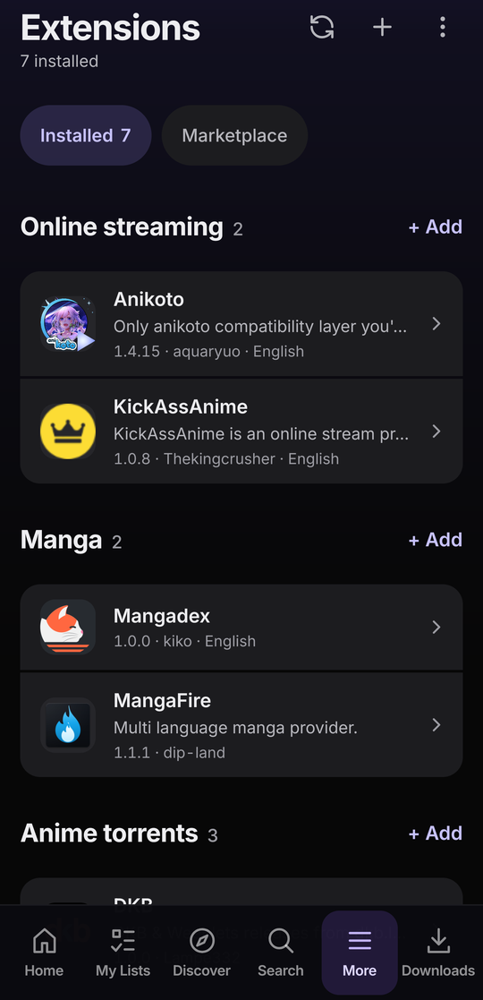

## Step 5: Watch your first episode

1. Open **Discover** or **Search** and tap a show.

   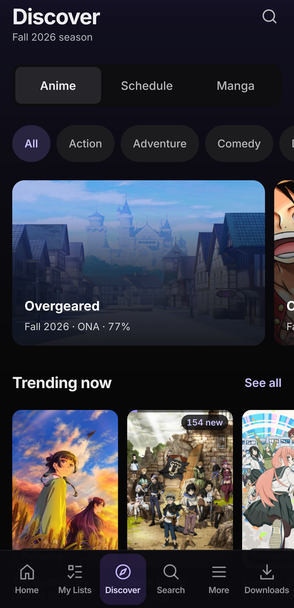

2. Above the episode list, switch to **Online**. The left dropdown picks the source, the right one picks the server. **Sub** and **Dub** sit right below.
3. Tap an episode. It starts playing.

   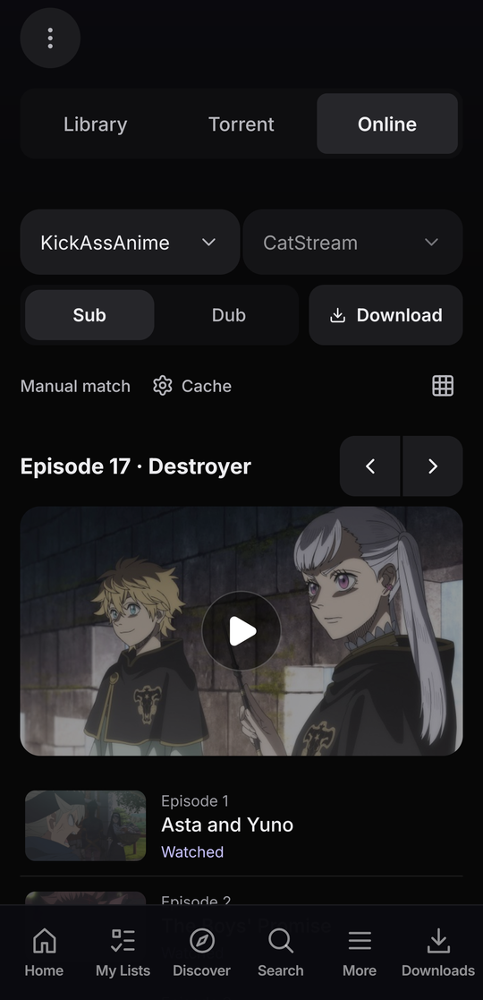

Episode won't start or keeps loading? It's almost always the source. Switch the source or the server and try again. Keep your extensions up to date too: in **Extensions**, the round arrow at the top checks for updates.

## Step 6: Read manga

1. Search for a manga and open it.
2. Tap a chapter, or **Start reading** at the top. The arrow on the right of a chapter downloads it.
3. If you're signed in to AniList, your progress goes to your list by itself.

   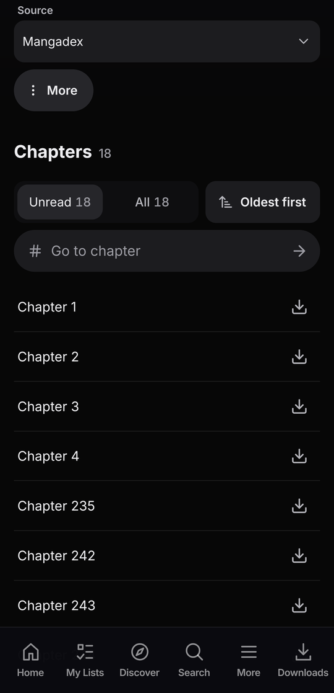

## Extras

### Torrents

Install a torrent source from the marketplace, then switch the anime page to **Torrent**. The app streams torrents itself, you don't need another app. Torrents use your connection, mobile data included, and the app asks before one starts on mobile data. Debrid is optional and sits in **More → Settings → Torrents & debrid**.

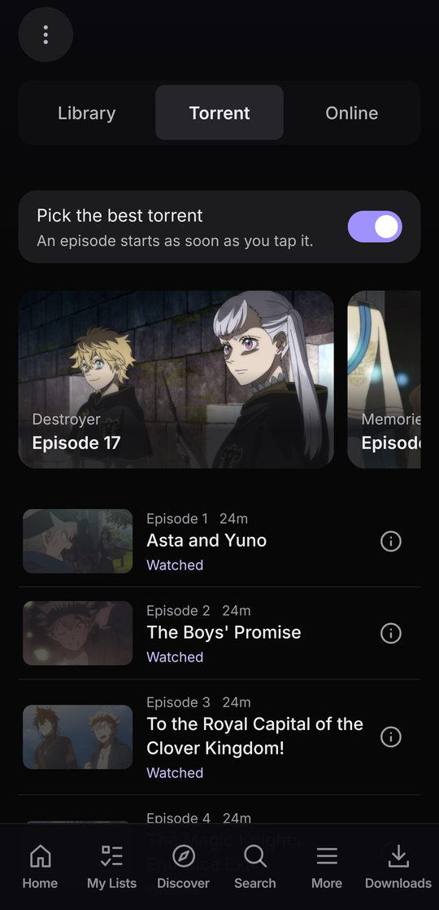

### Your own files

1. Go to **More → Settings → Local library**.

   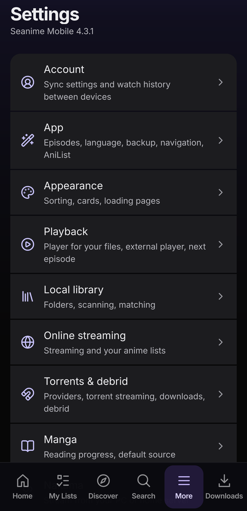

2. Tap **Library folder** and pick the folder with your episodes. The app needs **All files access** to read it.

   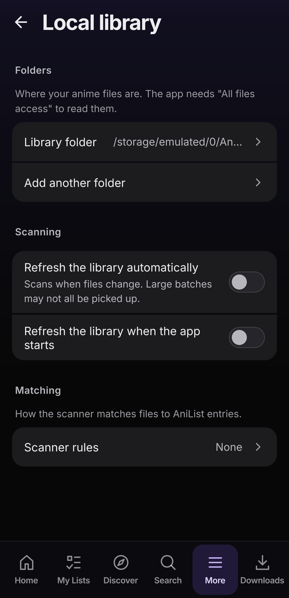

3. Your episodes then show up on the anime page under **Library**.

### Offline

Tap **Download** on the anime page and watch later without internet. Finished downloads are in the **Downloads** tab.

### Updates

The app checks GitHub for a new version every time it starts. Want a ping when one drops? Join the [Discord](https://discord.gg/dxJdj5Dqt9) and grab the **Release Pings** role.
